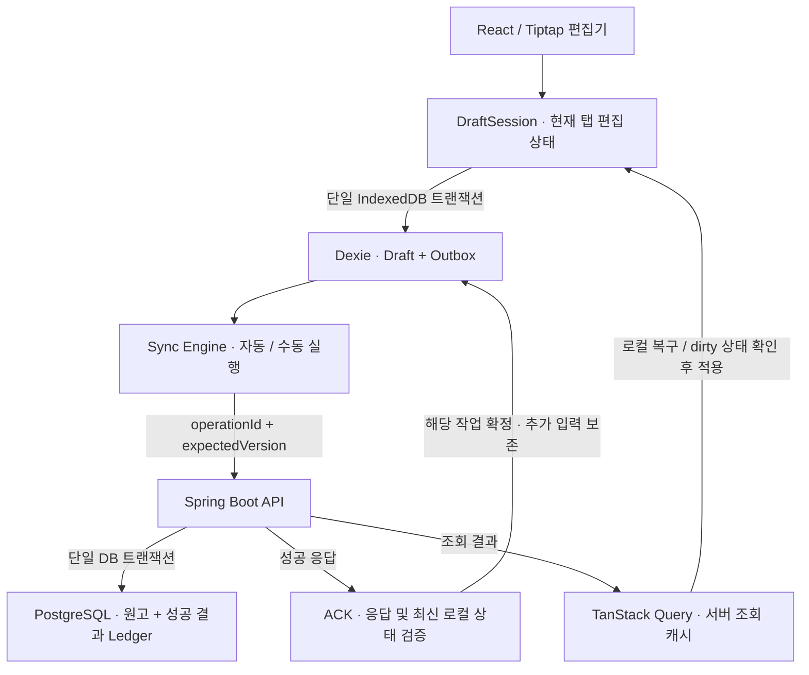

# Seam Note

**네트워크가 끊겨도 이어 쓰고, 기기를 바꿔도 작업을 이어갈 수 있도록 설계한 Local-first 노트 에디터입니다.**

작성한 내용은 브라우저에 먼저 보관하고, 서버 동기화는 별도의 작업으로 처리합니다. 연결이 불안정하거나 서버 응답이 유실되더라도 저장된 편집본과 전송 작업을 유지하고, 서로 다른 수정이 충돌하면 자동으로 덮어쓰는 대신 비교하고 선택할 수 있도록 만들었습니다.

| 항목 | 내용 |
| --- | --- |
| 개발 기간 | 2026.10 ~ 진행 중 |
| 개발자·역할 | 박주언 · 1인 Full-stack 개발 |
| 배포 | [seamnote.vercel.app](https://seamnote.vercel.app/) |
| 저장소 | [aubri61/seam-note](https://github.com/aubri61/seam-note) |

> 현재 배포는 공유 Basic 인증을 사용하는 검증 환경입니다. 이 브랜치의 사용자별 로그인·소유권 분리는 로컬 검증됐으며 현재 배포에는 아직 적용되지 않았습니다. 배포 검증 환경에는 테스트용 데이터를 사용합니다. 로컬 검증 결과와 배포 환경의 통합 검증 범위는 [검증 결과](#검증-결과)에서 구분합니다.

## 만든 배경

> “저장은 성공했는데, 왜 내가 쓴 글은 사라졌을까?”

웹소설을 집필하면서 동기화 실패로 작성한 내용이 유실되는 경험을 했습니다. 이 경험을 통해 글쓰기 도구에서 가장 중요한 것은 작성한 내용이 안전하게 보존되고, 언제든 작업을 이어갈 수 있다는 신뢰라고 생각했습니다.

해결하고 싶었던 문제는 오프라인 편집 지원에만 있지 않았습니다. 서버에 저장되기 전에 연결이 끊기는 상황, 서버에는 반영됐지만 응답만 유실되는 상황, 여러 기기에서 같은 원고를 수정하는 상황을 각각 다뤄야 했습니다. 사용자는 이 과정에서 지금 쓴 내용이 어디까지 저장됐는지도 알 수 있어야 합니다.

Seam Note는 이 문제를 다루기 위해 **로컬 저장 완료와 서버 동기화 완료를 분리하는 구조**를 선택했습니다. 편집은 로컬에서 이어가고, 서버와의 통신 실패는 보존된 작업을 바탕으로 복구하도록 설계했습니다.

## 해결하려는 세 가지 문제

| 문제 | 질문 | 접근 |
| --- | --- | --- |
| 네트워크 단절과 작업 유실 | 서버에 보내기 전에 연결이 끊기거나 앱이 종료되면 작성 내용을 어떻게 보존할까? | IndexedDB Draft + Transactional Outbox |
| 응답 유실과 중복 반영 | 서버가 처리한 요청을 다시 보내더라도 동일 작업이 두 번 반영되지 않게 하려면? | operationId 기반 멱등키 + 서버 Ledger + ACK |
| 여러 탭·기기의 수정 충돌 | 같은 원고의 서로 다른 수정이 상대의 내용을 덮어쓰지 않게 하려면? | 로컬 CAS + expectedVersion 검증 + 충돌 비교·선택 UI |

## 주요 기능

- **글쓰기와 정리**: Tiptap 기반 리치 텍스트 편집, 폴더·원고 생성과 관리, 원고별 URL 이동.
- **로컬 자동 저장**: 편집본과 서버 전송 작업을 IndexedDB에 함께 기록하고, 다시 열 때 로컬 원고를 복구합니다.
- **오프라인 작업**: PWA 자산과 로컬 데이터가 준비된 브라우저에서 원고를 다시 열고 편집하거나 새 폴더·원고를 만들 수 있습니다.
- **자동·수동 동기화**: 로컬 작업 커밋, 연결 복구, 포커스 복귀 등에 맞춰 동기화를 실행합니다. 전체 동기화 버튼과 `⌘S` / `Ctrl+S`도 지원합니다.
- **충돌 비교와 선택**: 서버 버전 충돌이나 다른 탭의 로컬 변경을 감지하면 현재 원고와 상대 원고를 비교하고 선택할 수 있습니다.
- **저장 상태 안내**: 로컬 저장 상태와 서버 동기화 상태를 구분해 표시합니다.

오프라인에서 서버의 모든 원고를 새로 불러올 수 있는 것은 아닙니다. 브라우저에 보관된 데이터가 복구의 기준이며, 다른 기기의 변경은 서버 재조회와 동기화 시점에 반영됩니다. 실시간 공동 편집이나 자동 병합을 제공하는 구조는 아닙니다.

## 아키텍처



### 1. 편집 상태와 서버 조회 캐시 분리

서버 조회 결과가 늦게 도착하거나 캐시가 갱신될 때, 이를 그대로 편집기에 대입하면 사용자의 입력이 이전 데이터로 바뀔 수 있습니다.

TanStack Query는 **서버 조회 결과**, DraftSession은 **현재 편집 상태**를 담당하도록 분리했습니다. 로컬 복구가 완료되기 전에는 서버 응답 적용을 보류하고, 수정 중인 Draft는 재조회 결과로 덮어쓰지 않습니다. 변경이 없는 원고는 더 높은 서버 버전으로 갱신할 수 있습니다.

단일 상태를 사용하는 방식보다 기준 버전과 상태 전환 관리가 복잡해지지만, 사용자 입력과 비동기 조회의 생명주기를 분리해 편집 내용 보존을 우선했습니다.

### 2. 로컬 영속화와 서버 전송 분리

Draft를 저장한 뒤 전송 작업을 따로 만들면, 중간에 앱이 종료될 때 편집본만 남고 서버에 반영할 작업이 누락될 수 있습니다.

이를 막기 위해 IndexedDB의 단일 트랜잭션으로 **Draft와 Outbox를 함께 기록**합니다. 별도의 Sync Engine이 저장된 작업을 읽어 전송과 재시도를 처리하며, 새 폴더·원고는 생성 큐와 부모 의존성을 확인해 순서대로 반영합니다.

Outbox 관리와 ACK·장애 복구 로직이 추가되는 비용을 감수하는 대신, 서버 연결 상태와 로컬 저장을 분리했습니다.

### 3. 중복 요청과 수정 충돌을 각각 검증

응답 유실 후 **같은 작업을 다시 보내는 경우**와, 다른 기기에서 **서로 다른 수정을 보내는 경우**는 별개의 문제입니다.

| 검증 | 기준 | 처리 |
| --- | --- | --- |
| 멱등성 | `operationId`를 `Idempotency-Key`로 전달 | 동일 키·동일 요청은 Ledger의 기존 성공 결과를 반환해 중복 반영과 불필요한 버전 증가 방지 |
| 서버 수정 충돌 | `expectedVersion`과 현재 원고 버전 비교 | 불일치하면 `409 VERSION_CONFLICT`, 로컬 원고를 보존하고 비교·선택으로 전환 |
| 로컬 수정 충돌 | IndexedDB의 token·revision을 CAS로 확인 | 다른 탭이 갱신한 사본을 오래된 쓰기가 덮어쓰지 않도록 거부 |

서버는 원고 변경과 성공 결과 Ledger를 같은 DB 트랜잭션에서 확정합니다. 원장과 버전 검증을 별도로 유지해야 하지만, 불확실한 요청의 재시도는 허용하면서 실제 수정 충돌은 차단할 수 있습니다.

## 동기화와 복구 흐름

> 서버의 불확실성을 사용자의 데이터 유실로 이어지게 하지 않는다.

1. **입력과 로컬 저장**: 입력은 메모리 편집 상태에 반영하고, Draft와 전송할 작업을 IndexedDB에 함께 커밋합니다. 로컬 저장은 기본 400ms debounce를 사용하며, 지속 입력 시 최대 대기 2초에 저장 시도를 예약합니다. 이는 디스크 커밋 완료 시간을 보장하는 수치가 아닙니다.
2. **전송할 요청 고정**: 전송 중인 작업의 키와 payload는 유지합니다. 전송 중 추가 입력이 생겨도 이미 보낸 요청의 내용을 바꾸지 않습니다.
3. **서버 처리와 재시도**: 서버가 원고와 Ledger를 함께 확정합니다. 응답이 유실되면 같은 키·같은 요청으로 재시도하고 기존 성공 결과를 받습니다.
4. **ACK 검증과 확정**: 응답의 작업 키·내용·버전을 검증하고 최신 로컬 token·revision을 다시 확인합니다. ACK 트랜잭션에서 해당 작업만 확정하고, 추가 입력이 있으면 보존한 채 새 서버 버전을 기준으로 후속 작업을 준비합니다.
5. **충돌 시 비교**: 서버 버전이나 로컬 CAS 충돌은 자동 덮어쓰기로 해결하지 않습니다. 비교 화면에서 선택한 사본을 로컬에 확정하고, 서버 충돌 해결은 온라인 확인과 저장·ACK를 거칩니다. 선택 중 다시 충돌하면 최신 상태를 다시 비교합니다.

서버 응답을 받자마자 큐 전체를 비우거나, 전송 당시의 원고를 현재 편집본에 대입하지 않는 것이 핵심입니다.

## 개발 중 다룬 문제

### 전송 중 추가 입력과 ACK 경쟁

느린 네트워크에서 이전 요청의 성공 응답이 돌아오는 동안 사용자가 계속 입력하면, 이전 저장 결과가 최신 입력을 덮거나 후속 작업이 누락될 수 있습니다. 전송 snapshot과 최신 Draft를 구분하고 ACK 과정에서 해당 작업만 확정하도록 구성했습니다. 최신 내용 보존, 기준 버전 갱신, 후속 작업 생성은 같은 IndexedDB 트랜잭션으로 처리합니다.

### 실제 수정이 없는데 발생한 멀티탭 충돌

동일 IndexedDB를 공유하는 탭에서 한 탭의 ACK 이후, 다른 탭은 내용이 바뀌지 않았는데도 충돌로 판단해 동기화가 중단되는 문제가 있었습니다. 편집 내용, 마지막 로컬 커밋 checkpoint, 동기화 token을 구분해 비교 기준을 개선했습니다. ACK 메타데이터만 바뀐 경우에는 안전하게 재조정하되, 실제 편집 충돌에는 CAS 검증을 유지했습니다.

### 서버 GET과 로컬 복구의 도착 순서

로컬 원고를 읽기 전에 서버 응답을 적용하면 아직 복구하지 못한 편집본이 대체될 위험이 있습니다. 이 위험은 IndexedDB 도입 시 식별해 Recovery Barrier와 dirty 보호로 예방했습니다. 실제 과거 제품에서 원고 유실이 발생해 수정한 사례와 구분합니다.

## 검증 결과

아래는 저장소에 보관한 **해당 날짜·환경의 실험 결과**입니다. 모든 브라우저나 현재 배포 환경의 무오류를 보장하는 수치는 아닙니다.

| 검증 | 결과 | 조건과 근거 |
| --- | --- | --- |
| 로컬 복구와 서버 응답의 순서 경쟁 | 로컬 원고 보존 **160/160회**, 최종 덮어쓰기 **0회** | 2026-10-25 실제 Chrome·IndexedDB, 2만 자 합성 원고. GET·로컬 read에 각각 0/100/500/1000ms 지연을 주입한 16조합 × 10회. |
| 서버 응답 유실·Chrome 강제 종료 후 복구 | **4/4 조건 통과** | 2026-10-28 격리 DB·브라우저. 서버 도달 전/commit 후 응답 유실, 후속 작업 부재·ACK 삽입 실패 주입 포함. 각 작업 Ledger 1건, 최종 서버 v4·Outbox 0 확인. |

160회 실험은 예방 설계의 검증이며, 가상 비교 모델의 실패 횟수를 실제 제품의 과거 데이터 손실 횟수로 사용하지 않습니다. 강제 종료 실험의 일부 조건도 테스트에서 인위적으로 주입한 상태입니다. OS 전원 차단, 디스크 고장, 브라우저 저장소 회수까지 검증한 결과는 아닙니다.

관련 회귀 검증은 [프론트엔드 테스트](frontend/tests), [브라우저 하네스](frontend/tests/browser), [백엔드 통합 테스트](backend/src/test/java/com/seamnote/backend)에 있습니다.

## 기술 스택과 역할

| 영역 | 기술 | 역할 |
| --- | --- | --- |
| 프론트엔드 | React, TypeScript, Vite | 편집 UI와 타입 기반 상태 관리, 빌드 |
| UI·편집기 | Emotion, Tiptap | 스타일과 리치 텍스트 편집 |
| 서버 조회 | TanStack Query, Axios | 서버 조회 캐시와 HTTP 통신 |
| 로컬 저장 | IndexedDB, Dexie | Draft·Outbox·로컬 엔티티의 영속화와 트랜잭션 |
| 오프라인 앱 | vite-plugin-pwa, Workbox | 앱 정적 자산 캐시와 오프라인 재실행. API 응답은 SW 캐시에서 제외 |
| 백엔드 | Java 21, Spring Boot, Spring Data JPA | API, 버전 검증, 멱등 처리와 트랜잭션 |
| 데이터베이스 | PostgreSQL, Flyway | 서버 확정 상태·Ledger 저장과 스키마 이력 |
| 배포 | Vercel, EC2, Docker, Caddy, Supabase PostgreSQL | 프론트엔드·API 프록시, 백엔드 실행, HTTPS, 관리형 DB |

## 로컬 실행

Node.js 22.x, pnpm 10.32.1, Java 21, Docker Compose가 필요합니다. 아래 명령은 별도 안내가 없으면 저장소 루트에서 실행합니다.

```bash
# PostgreSQL: localhost:15439
docker compose up -d postgres

# 백엔드: localhost:18765
cd backend
# .env.local 로딩 + 누락된 로컬 JWT 키 최초 생성·저장
python3 run-local.py
```

로컬 실행 스크립트에는 Python 3이 필요합니다. `backend/.env.local`의 `KEY=value`와 따옴표 값을 읽으며 셸 명령·변수 치환은 실행하지 않습니다. 이미 설정한 셸 환경변수가 우선합니다. 파일과 비밀키는 Git에 포함되지 않습니다. 일반 `./gradlew bootRun`이나 IDE 직접 실행은 이 파일을 자동으로 읽지 않으므로 환경변수를 별도로 전달해야 합니다. 운영·테스트에는 이 스크립트를 사용하지 않습니다.

다른 터미널에서 프론트엔드를 실행합니다.

```bash
cd frontend
pnpm install --frozen-lockfile
pnpm dev
```

Vite가 출력한 로컬 주소로 접속합니다. `/api` 요청은 기본적으로 `http://127.0.0.1:18765`로 전달되며, 다른 백엔드를 사용하려면 `SEAM_NOTE_API_TARGET`을 설정합니다. 기본 DB 설정은 로컬 개발용이고, PWA 오프라인 재실행은 개발 서버 대신 production build·preview에서 확인합니다.

```bash
# frontend 디렉터리에서
pnpm test
pnpm lint
pnpm build
pnpm preview
```

백엔드 테스트에는 별도의 테스트 PostgreSQL을 준비하고 `TEST_DB_URL`, `TEST_DB_USERNAME`, `TEST_DB_PASSWORD`를 설정합니다. `TEST_JWT_SECRET_BASE64`에도 `openssl rand -base64 64`로 생성한 테스트 전용 난수 키를 설정한 뒤 `backend`에서 `./gradlew test`를 실행합니다. 키 값은 출력·커밋하지 않고, 개발·운영 키와 DB를 재사용하지 않습니다.

## 인증 구현과 검증

이메일·비밀번호·닉네임 가입과 Google OIDC 로그인은 같은 내부 사용자 UUID 및 HS256 Access/opaque Refresh 세션을 사용합니다. Access는 메모리, Refresh는 HttpOnly Cookie에 보관하며 서버에는 Refresh 해시만 저장합니다. API·멱등성 Ledger와 브라우저 원고/Outbox를 사용자·서버 환경별로 분리합니다. 로그아웃으로 미전송 원고를 삭제하지 않습니다.

로컬 Google 로그인은 `backend/.env.example`을 참고해 `backend/.env.local`에 Client ID/Secret과 등록된 callback을 입력하고 `python3 run-local.py`로 실행합니다. frontend에는 비밀값을 입력하지 않습니다. Vite는 callback 주소에 맞춰 5173 포트를 고정합니다. 기존 소유자 없는 데이터는 비활성 보관 계정 아래 남으며 첫 가입자에게 자동 이전하지 않습니다.

2026-11-04 격리 PostgreSQL의 backend 69개, frontend 233개 및 build/typecheck/lint, 일회성 production-profile Docker TLS/HTTPS 검사 24개를 통과했습니다. 실제 Chrome 두 탭의 계정 전환·미전송 원고 보존·동일 계정 재인증, 사용자 계정으로 Google localhost 왕복, production PWA의 서비스 중단 중 재실행/편집본 복구를 확인했습니다. 이 결과는 운영 배포 완료나 일반 공개 준비 완료를 의미하지 않습니다. 배포 전환은 [운영 가이드](deploy/README.md)를 따릅니다.

## 현재 한계와 다음 과제

- **인증 운영 전환**: 이메일/비밀번호·Google OIDC, JWT/Refresh 회전, 사용자별 API/Ledger 및 로컬 원고 격리를 구현했습니다. 운영 배포와 메일 검증·비밀번호 재설정은 별도 공개 전 필수 작업입니다.
- **브라우저 저장소의 한계**: IndexedDB 커밋 전 메모리 입력, 사용자의 저장소 삭제, 브라우저 저장소 회수, 기기 고장에 대한 외부 백업 보장은 없습니다.
- **원격 변경 반영**: 조회·포커스·연결 복구 등의 계기를 통해 수렴합니다. 실시간 push 기반 공동 편집과 자동 병합은 지원하지 않습니다.
- **배포 환경 통합 검증**: 로컬 장애 주입 실험과 별도로 인증된 Vercel 환경에서 CRUD·멱등성·409·PWA 자동 동기화 전체 흐름을 검증해야 합니다.
- **로딩 성능**: 원고 상세 조회 지연 조사에서 EC2와 DB 사이의 왕복 지연 및 Vercel 함수 경유 비용을 확인했습니다. 리전 배치와 조회 경로 개선은 별도 과제이며, 개선을 적용한 결과로 소개하지 않습니다.
