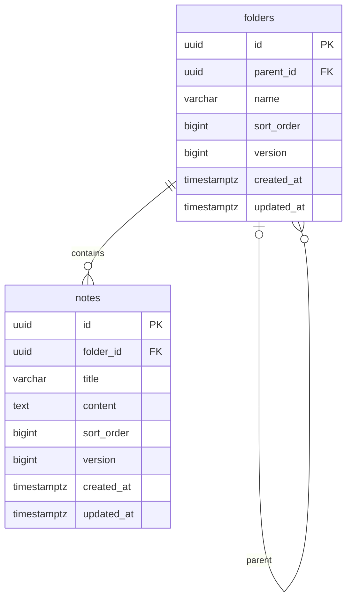

# Folder 중심 DB/API 개편

## Phase A — 기존 구조와 영향

- Note: UUID PK(`@GeneratedValue(UUID)`), title VARCHAR(200) NOT NULL, content TEXT NOT NULL, created_at/updated_at TIMESTAMPTZ NOT NULL. 관계·정렬·버전 없음.
- NoteRepository: JpaRepository. 서비스는 save() 생성 및 dirty checking 수정, 컨트롤러에서 DTO 변환.
- POST /api/notes, GET /api/notes, GET /api/notes/{id}, PUT /api/notes/{id}, DELETE /api/notes/{id}.
- 생성/수정 title @NotBlank + @Size(200), content @NotNull. 따라서 빈 제목 거부.
- ErrorResponse {code,message,errors:[{field,message}]}, BusinessException/ErrorCode 사용. 잘못된 UUID/JSON/DB 충돌의 공통 처리 누락.
- PostgreSQL 17(Docker 구성), Flyway V1만 존재, ddl-auto=validate, open-in-view=false. 실제 공유 DB 데이터 수와 적용 이력은 조회하지 않음.
- 테스트는 contextLoads 하나. 프론트엔드 FolderItem/useFolders는 샘플 데이터와 React 상태만 사용. fetch/axios/Query API 의존성 없음. React Arborist는 이미 설치됨.
- 위험: folder_id를 바로 NOT NULL 추가하면 기존 데이터가 있는 DB에서 실패. 수동 UUID에 save()를 사용하면 merge에 의한 덮어쓰기 우려. 부모 검사만으로 동시 이동 순환을 막을 수 없음.

## Phase B — 결정과 구현 순서



1. V2 추가: folders 생성 → notes.folder_id nullable 추가 → 기존 노트가 있을 때만 보관 폴더 생성 → 기존 노트 연결 → FK/NOT NULL/인덱스 적용. ID, 제목, 본문, 두 타임스탬프는 변경하지 않음.
2. 단방향 LAZY ManyToOne만 사용. 삭제 cascade 없음. 이름 trim 후 1~200자. Note 제목/본문은 필수(누락·null 400), 빈 문자열 허용. 생성 folderId 필수. 기존 생성 계약의 folderId 추가는 요구사항에 따른 의도적 변경이며 현재 프론트엔드 API 소비자는 없음.
3. ID 선택 입력: null/누락이면 서버 UUID, 전달되면 그대로 persist. 중복은 409. 같은 UUID 재요청도 409이며 멱등 처리 성공을 의미하지 않음. 엔티티별 ID 공간은 독립.
4. sort_order는 bigint 0부터 append(max+1), 이동하면 새 부모 끝, 같은 부모 이동은 no-op. 부모별 unique 인덱스(root는 별도 partial index), 정렬은 sort_order/id. 수동 정렬 API는 후속 작업.
5. @Version Long: 신규 null을 Hibernate가 0으로 초기화, 기존 행 0 backfill. 후속 개편으로 Note 내용 수정에는 필수 expectedVersion을 적용했다. 클라이언트 버전 불일치와 동시 트랜잭션 충돌은 409. Note 이동·Folder 변경에는 아직 요청 버전 검증이 없다.
6. 구조 변경(폴더 생성/수정/이동/삭제, 노트 생성/이동/삭제)에 동일 PostgreSQL transaction advisory lock 사용. 잠금을 먼저 획득하고 상태를 읽어 동시 순환/삭제/append 경쟁 방지. 여러 서버 인스턴스에서도 같은 DB가 잠금 공유. 직접 SQL 및 잠금 규약을 우회하는 외부 쓰기는 지원하지 않음. 전역 잠금은 초기 규모의 단순성 선택이며 대규모 workspace 도입 때 범위 축소 필요.
7. DTO는 기존 클래스 방식 유지. 트랜잭션 안에서 변환. 기존 GET /api/notes는 본문 포함 호환 유지, 새 폴더별 목록은 projection으로 본문 SELECT도 제외.
8. 테스트: 임시 PostgreSQL에서 V1→V2 빈/기존 데이터 경로, 필드 보존 및 제약 검증 → 실제 API CRUD/검증/동시 이동 테스트 → 프론트엔드 build/lint/test.

## 공유 DB 적용 전

이번 작업은 공유 DB에 SQL/Flyway를 실행하지 않는다. 적용 전 운영자가 notes 전체와 Flyway 이력을 포함한 검증 가능한 백업을 보관하고 복구 리허설을 해야 한다. V2는 notes 전체 backfill과 인덱스 생성, ALTER 제약으로 쓰기 잠금/배포 시간이 필요하다(실제 규모별 시간 미측정). 유지보수 구간에서 기존 앱 쓰기를 중지하고 백업 기준 행별 ID/title/content/created_at/updated_at 비교를 한다. PostgreSQL의 트랜잭션 안에서 실행되며 실패 시 V2 전체 rollback, 성공 후에는 임의 down migration 대신 백업 복구/전진 수정 계획을 사용한다. 신규 데이터가 생긴 뒤 백업 복구는 별도 데이터 병합이 필요하다.

## 향후 동기화

IndexedDB/Outbox, operationId 처리 결과 테이블, If-Match 및 Note 이동·Folder 변경의 요청 버전 계약, 권한 검증, 삭제 tombstone은 미구현. Note 내용 수정의 expectedVersion은 아래 후속 계약으로 구현했다. 조회 대상 폴더를 찾는 서비스 경계에 workspace 소유권 검증을 추가해야 한다. 현재 DELETE는 물리 삭제이며 tombstone 도입 시 delete 서비스/조회 필터/변경분 피드와 보관 기간 계약을 함께 바꿔야 한다. 프론트엔드 UI 연결은 API 계약과 분리하며 기존 샘플 UI 디자인은 유지한다.

## API 계약

모든 UUID는 JSON 문자열. FolderResponse는 `{id,parentId,name,sortOrder,version,createdAt,updatedAt}`, NoteResponse는 `{id,folderId,title,content,sortOrder,version,createdAt,updatedAt}`. NoteSummaryResponse는 `{id,folderId,title,sortOrder,version,updatedAt}`. 시간은 ISO-8601 Instant. 성공 본문은 DTO 또는 배열이며 별도 envelope 없음. 생성 응답에는 Location 헤더가 있다.

| Method | URL | 요청 DTO/쿼리 | 응답 DTO | 성공 |
| --- | --- | --- | --- | --- |
| GET | /api/folders | parentId 생략 또는 root: 최상위, UUID: 직접 자식 | FolderResponse[] | 200 |
| GET | /api/folders/{id} | 없음 | FolderResponse | 200 |
| GET | /api/folders/{id}/children | 없음, 직접 하위 Folder만 | FolderResponse[] | 200 |
| GET | /api/folders/{id}/notes | 없음, 해당 Folder의 원고만 | NoteSummaryResponse[] | 200 |
| POST | /api/folders | CreateFolderRequest `{id?,parentId?,name}` | FolderResponse | 201 |
| PATCH | /api/folders/{id} | UpdateFolderRequest `{name}` | FolderResponse | 200 |
| PATCH | /api/folders/{id}/move | MoveFolderRequest `{targetParentId}` | FolderResponse | 200 |
| DELETE | /api/folders/{id} | 없음 | 없음 | 204 |
| GET | /api/notes | 없음, 기존 본문 포함 전체 목록 유지 | NoteResponse[] | 200 |
| GET | /api/notes/{id} | 없음 | NoteResponse | 200 |
| POST | /api/notes | CreateNoteRequest `{id?,folderId,title,content}` | NoteResponse | 201 |
| PUT / PATCH | /api/notes/{id} | UpdateNoteRequest `{title,content,expectedVersion}` 모두 필수 | NoteResponse | 200 |
| PATCH | /api/notes/{id}/move | MoveNoteRequest `{targetFolderId}` | NoteResponse | 200 |
| DELETE | /api/notes/{id} | 없음 | 없음 | 204 |

- Folder 생성 parentId 누락/null: 최상위. 이동 targetParentId는 필드가 반드시 있어야 하며 null은 최상위 이동. 자기 자신/자손 이동은 409.
- Folder name 누락/null/공백/200자 초과: 400. 저장 전 앞뒤 Unicode 공백을 strip한다. 길이 검증은 입력 문자열 기준이다.
- Note 생성/내용 수정 title/content 누락 또는 null: 400, `""` 허용. title 200자 이하. content TEXT. PUT/PATCH는 두 내용 필드를 모두 교체하며 한 필드만 보내면 400. expectedVersion도 필수이며 null·음수는 400, 현재 서버 version과 다르면 409. folderId는 이동 API에서만 바꾼다.
- ID 누락/null: 서버 UUID, 유효 UUID: 보존, 같은 엔티티 유형의 중복 ID: 409 DUPLICATE_ENTITY_ID. 다른 유형의 동일 UUID는 허용된다. 재시도 멱등성은 제공하지 않는다.
- 자식 목록을 조합할 때 UI는 Folder 목록 다음 Note 목록을 표시한다. 이 API는 전체 트리를 재귀 반환하지 않는다.

공통 오류 형식: `{ "code": "...", "message": "...", "errors": [] }`. DTO 검증 오류만 errors에 field/message를 담는다. SQL/요청 원문 등 민감한 내부 정보는 반환하지 않는다.

| 적용 요청 | HTTP | code |
| --- | --- | --- |
| 모든 UUID 경로/쿼리 및 DTO 검증 실패 | 400 | INVALID_REQUEST |
| 읽을 수 없는 JSON/JSON UUID | 400 | MALFORMED_JSON |
| Folder 조회/목록 부모/수정/이동/삭제, Note 생성·이동의 폴더 없음 | 404 | FOLDER_NOT_FOUND |
| Note 단건/수정/이동/삭제 대상 없음 | 404 | NOTE_NOT_FOUND |
| Folder 삭제에 하위 Folder/Note 존재 | 409 | FOLDER_NOT_EMPTY |
| Folder 이동으로 자기 자신/자손 순환 | 409 | FOLDER_CYCLE_DETECTED |
| Folder/Note 생성 UUID 중복 | 409 | DUPLICATE_ENTITY_ID |
| expectedVersion 불일치 또는 동시 갱신 @Version 충돌 | 409 | VERSION_CONFLICT |
| FK/정렬 유일성 등 DB 무결성 충돌 | 409 | DATA_CONFLICT |

기존 NOTE_VERSION_CONFLICT 코드는 호환성을 위해 유지하지만 신규 공통 충돌은 VERSION_CONFLICT를 사용한다. 현재 인증/인가 자체가 없으므로 workspace 격리는 제공하지 않는다.

## 검증 실행 방법

기존 DB와 분리된 PostgreSQL 17의 빈 테스트 전용 DB를 명시해야 한다. test 프로필에 기본 URL이 없어서 TEST_DB_URL 없이 실수로 개발 DB를 마이그레이션하지 않는다. 사용자/비밀번호는 TEST_DB_USERNAME/TEST_DB_PASSWORD로 지정할 수 있다.

```sh
cd backend
TEST_DB_URL=jdbc:postgresql://127.0.0.1:25439/seam_note_test ./gradlew test bootJar --offline
cd ../frontend
pnpm build
pnpm lint
pnpm test
```

마이그레이션 테스트는 전용 DB 안의 매번 새 schema에서 실제 Flyway로 V1을 먼저 적용하고 샘플 데이터를 저장한 다음 V2로 전환한다. 원본 다섯 필드를 행 단위 비교하고 FK/NOT NULL/정렬 중복 제약 및 재실행(no-op)을 검증한다. 실제 API 테스트는 RANDOM_PORT 서버를 사용한다. 동시 이동 두 요청, 동시 원고 8개 생성, DB 행 잠금으로 강제한 동시 내용 갱신 충돌을 포함한다.

## Phase D — 최초 Folder 개편 검증 결과 및 한계

- PostgreSQL 17 일회용 컨테이너에서 백엔드 JUnit 10개(마이그레이션 2, API 7, context 1) 통과. API 테스트 한 메서드에서 여러 입력 경계를 검증한다. bootJar 빌드 성공.
- 빈 원고, 200/201자, 누락/null/빈 문자열 구분, 잘못된 UUID, DTO/상태/Location, UUID 중복 시 원문 보존, 기본/하위 Folder, 이름 trim/rename, 직접 자식 조회, root 이동, 자기/자손 이동 차단, 비어 있지 않은 Folder 삭제 차단, 원고 이동/삭제, 안정적 정렬, 동시 이동·생성·수정 충돌 검증.
- 기존 데이터 마이그레이션은 한글·줄바꿈·긴 본문·빈 문자열과 마이크로초 timestamp를 포함해 V1의 5개 필드 전체를 비교했다. 신규 FK/NOT NULL/순서 unique와 Flyway 재실행도 검증했다. V1 원본 파일은 수정하지 않았다.
- 프론트엔드 build/lint 및 기존 테스트 13개 통과. 소스·디자인은 변경하지 않았다. 현재 화면은 계속 세션 내 샘플 상태이며, 새 원고 버튼과 서버 API를 연결한 온라인 UI 흐름은 이번 백엔드 개편에 포함하지 않았다. 연결 시 FolderItem의 parentId와 API folderId를 매핑하고, 루트 직접 원고 생성은 유효한 Folder 선택/생성으로 바꾸며, 실패·저장 상태를 처리해야 한다.
- 실제 공유 DB의 데이터 보존·백업 복구 리허설, 큰 데이터에서 backfill/잠금 시간, 다중 서버 부하, 프론트엔드와 서버 통합 E2E는 미검증. 구조 변경 잠금은 모든 workspace에 걸친 전역 잠금이며, 깊은 경로 이동 검사는 경로 길이에 비례하는 조회를 사용한다. 성능 수치는 측정하지 않았다.
- 테스트는 별도 임시 컨테이너와 DB/schema에서만 실행했으며 기존 seam-note-db에는 SQL을 실행하지 않았다.

## 변경 파일 목록
- `backend/src/main/java/com/seamnote/backend/common/exception/ErrorCode.java`
- `backend/src/main/java/com/seamnote/backend/common/exception/GlobalExceptionHandler.java`
- `backend/src/main/java/com/seamnote/backend/folder/controller/FolderController.java`
- `backend/src/main/java/com/seamnote/backend/folder/dto/CreateFolderRequest.java`
- `backend/src/main/java/com/seamnote/backend/folder/dto/FolderResponse.java`
- `backend/src/main/java/com/seamnote/backend/folder/dto/MoveFolderRequest.java`
- `backend/src/main/java/com/seamnote/backend/folder/dto/UpdateFolderRequest.java`
- `backend/src/main/java/com/seamnote/backend/folder/entity/Folder.java`
- `backend/src/main/java/com/seamnote/backend/folder/repository/FolderRepository.java`
- `backend/src/main/java/com/seamnote/backend/folder/service/FolderService.java`
- `backend/src/main/java/com/seamnote/backend/folder/service/FolderStructureLock.java`
- `backend/src/main/java/com/seamnote/backend/note/controller/NoteController.java`
- `backend/src/main/java/com/seamnote/backend/note/dto/CreateNoteRequest.java`
- `backend/src/main/java/com/seamnote/backend/note/dto/MoveNoteRequest.java`
- `backend/src/main/java/com/seamnote/backend/note/dto/NoteResponse.java`
- `backend/src/main/java/com/seamnote/backend/note/dto/NoteSummaryResponse.java`
- `backend/src/main/java/com/seamnote/backend/note/dto/UpdateNoteRequest.java`
- `backend/src/main/java/com/seamnote/backend/note/entity/Note.java`
- `backend/src/main/java/com/seamnote/backend/note/repository/NoteRepository.java`
- `backend/src/main/java/com/seamnote/backend/note/service/NoteService.java`
- `backend/src/main/resources/db/migration/V2__add_folders_and_note_ownership.sql`
- `backend/src/test/java/com/seamnote/backend/BackendApplicationTests.java`
- `backend/src/test/java/com/seamnote/backend/FolderMigrationTests.java`
- `backend/src/test/java/com/seamnote/backend/FolderNoteApiTests.java`
- `backend/src/test/resources/application-test.yml`
- `docs/design/folder-api.md`
- `docs/troubleshooting/2026-10-25-backend-folder-contract.md`
- `docs/troubleshooting/README.md`

## 상세 작업 이력

실제 수행 순서와 파일별 변경 전후·이유, 실행 오류·검증 내역은 [2026-10-25 작업 이력](../worklogs/2026-10-25-backend-folder-api.md)에 기록했다.

## Note 내용 수정 expectedVersion 후속 계약 (2026-10-25)

### 변경 전 분석과 동작

Note에는 @Version Long이 있고 NoteResponse.version을 반환하지만, 이전 UpdateNoteRequest는 클라이언트 버전을 받지 않았다. 서버 version 1에 expectedVersion 0인 PUT을 보낸 재현 테스트가 예상 409 대신 실제 200을 반환하며 version 2로 오래된 내용을 저장했다. 아래 계약은 이 위험을 막기 위한 의도적인 PUT/PATCH 요청 변경이다. 현재 프론트엔드는 API 미연결이므로 호출부는 변경하지 않았다.

PUT/PATCH /api/notes/{id}는 `{title,content,expectedVersion}`을 모두 받는다. expectedVersion은 Long이며 필수, null/음수 불가. 제목·본문은 여전히 필수이며 빈 문자열을 허용하고 제목은 최대 200자다. 생성 및 이동 요청 계약은 그대로다.

수정 순서는 Note 조회 → Objects.equals로 서버 version과 expectedVersion 비교 → 불일치 시 기존 VERSION_CONFLICT BusinessException → 일치 시 title/content 수정 → 기존 flush → NoteResponse다. 응답 version은 flush 후 JPA가 증가시킨 값이며 서버 코드가 직접 증가시키지 않는다. 비교 뒤 다른 트랜잭션이 먼저 수정했을 때도 기존 @Version 조건부 UPDATE가 실패해 409가 된다. 실패 트랜잭션은 rollback된다.

### 실제 요청·응답

분리된 PostgreSQL 17 DB와 임시 서버에서 합성 원고로 수집했다. 생성부터 오류·재조회까지 전체 교환은 [실제 JSON 기록](../examples/note-expected-version.json)에 있다. UUID와 시각은 이 검증에서 생성된 값이다.

`PUT /api/notes/ebaaade4-1199-49a8-90cb-a1e6bfea72ec` 요청:

```json
{
  "title": "1화",
  "content": "수정한 원고 내용",
  "expectedVersion": 0
}
```

HTTP 200 응답:

```json
{
  "content": "수정한 원고 내용",
  "createdAt": "2026-10-25T05:40:44.760640Z",
  "folderId": "f7cbf370-9f48-4540-adb7-cefb3e00939a",
  "id": "ebaaade4-1199-49a8-90cb-a1e6bfea72ec",
  "sortOrder": 0,
  "title": "1화",
  "updatedAt": "2026-10-25T05:40:44.778716Z",
  "version": 1
}
```

버전 흐름은 생성 0 → expectedVersion 0 수정 성공/응답 1 → expectedVersion 1로 빈 제목·본문 수정 성공/응답 2다. 이후 expectedVersion 0 요청은 HTTP 409이며, GET의 전체 응답이 직전 성공 응답과 일치했다(제목·본문·version·시각 포함).

```json
{
  "code": "VERSION_CONFLICT",
  "message": "다른 요청이 먼저 데이터를 변경했습니다.",
  "errors": []
}
```

expectedVersion 누락/null/음수는 HTTP 400 INVALID_REQUEST이며 errors에 expectedVersion 필드가 포함된다. 충돌 응답에 서버 원고 전체를 덧붙이지 않는다. 클라이언트는 GET으로 최신 서버 문서를 별도로 조회한다.

### 다른 변경 API 분석 — 구현 범위 밖

| API | 현재 보호와 남은 위험 | 후속 버전 계약 |
| --- | --- | --- |
| Note 이동 | 구조 잠금과 @Version이 있어도 순차 도착한 오래된 이동 대상은 다시 적용될 수 있음 | 이동할 Note의 expectedVersion 필수, 잠금 후 대상 조회·버전 확인. Note version은 내용과 이동이 공유하므로 이동 후 내용 수정도 최신 version 필요 |
| Folder 이동 | 순환·정렬 보호와 별개로 오래된 부모 선택이 최신 이동을 되돌릴 수 있음 | 이동할 Folder의 expectedVersion 필수, 구조 잠금 뒤 버전 비교. 대상 부모의 구조/존재 검사 유지 |
| Folder 이름 변경 | 구조 잠금으로 요청이 직렬화되어도 오래된 이름이 최신 이름을 덮어쓸 수 있음 | 변경할 Folder의 expectedVersion 필수, 잠금 뒤 내용 변경 전 비교 |

이번에는 위 API나 잠금·EntityManager·엔티티·DB 스키마를 변경하지 않았다. 부모/대상 Folder의 버전까지 요구할지는 향후 작업 의미에 따라 별도 결정해야 하며 지금 구현됐다고 간주하면 안 된다.

### 프론트엔드 충돌 해결 UX

- 마지막으로 확인한 서버 version을 로컬 편집 내용과 함께 보관하고 PUT/PATCH에 expectedVersion으로 전달한다.
- 성공 응답의 version과 내용만 해당 저장 요청의 기준에 반영한다. 저장 중 추가 입력이 생겼다면 해당 입력은 유지한다. 같은 문서의 저장 요청 순서를 관리한다.
- 409 시 로컬 원고/Outbox 작업을 삭제하거나 자동 덮어쓰기 재시도하지 않는다. 자동 저장을 충돌 상태로 전환하고 로컬 초안을 보존한다.
- 별도 GET으로 최신 서버 내용을 가져와 로컬/서버 비교, 병합, 사본 보존 등의 선택을 제공한다. 사용자가 병합을 확정한 결과만 최신 서버 version을 expectedVersion으로 재전송한다. 재차 409이면 다시 해결한다.
- 이동 후에도 Note version이 바뀌므로 최신 이동 응답을 편집 기준에 반영해야 한다. 버전 번호를 클라이언트에서 임의 증가시키지 않는다.
- 이 계약은 stale write 방지이며 operationId 기반 멱등성을 제공하지 않는다. 응답 유실 재전송이 409이면 조회 후 상태를 확인해야 한다.

### 검증 결과

`TEST_DB_URL=jdbc:postgresql://127.0.0.1:25439/seam_note_version_test ./gradlew test bootJar --offline` 성공. 격리 PostgreSQL 17에서 JUnit 13개(API 10/마이그레이션 2/context 1), 실패·오류·스킵 0. 서버 버전 0→1→2, PUT/PATCH의 stale 거부·전체 응답 보존, null/누락/음수, 빈 제목·본문, 내용 필수·제목 길이 회귀를 검증했다.

동시 수정 테스트는 JDBC SELECT FOR UPDATE로 테스트 원고를 잠근 상태에서 동일 expectedVersion 0인 PUT/PATCH 두 요청을 실행하고, 두 UPDATE가 실제 DB 잠금에 대기하는 것을 확인한 뒤 잠금을 해제했다. 두 요청 모두 서비스의 버전 검사를 통과한 조건에서도 한 요청만 200/version 1, 다른 요청은 409이며 최종 원고가 성공 응답과 일치했다. 테스트 SQL은 version/본문을 직접 변경하지 않는다.

프론트엔드·DB 마이그레이션·공유 DB는 이번 작업에서 변경하거나 적용하지 않았다. 운영 데이터·다중 서버 성능·프론트엔드 E2E는 미검증이다. [작업 순서와 파일별 변경 이력](../worklogs/2026-10-25-note-expected-version.md)에 실행 내역을 기록했다.
