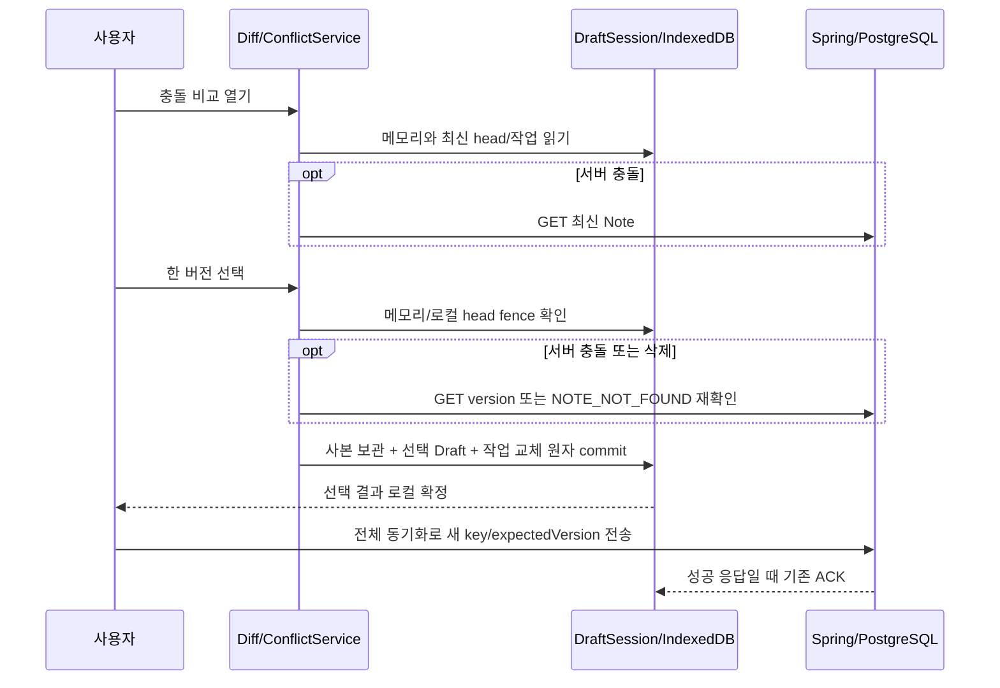
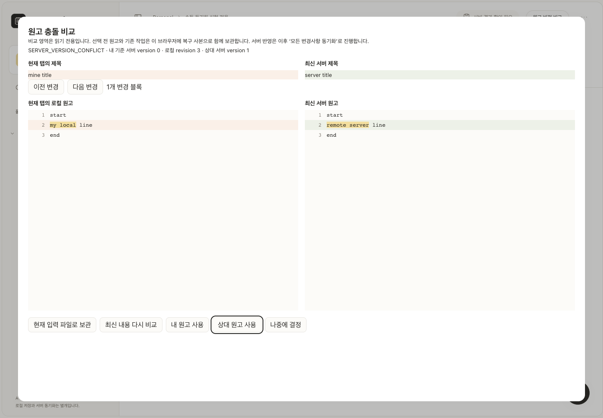
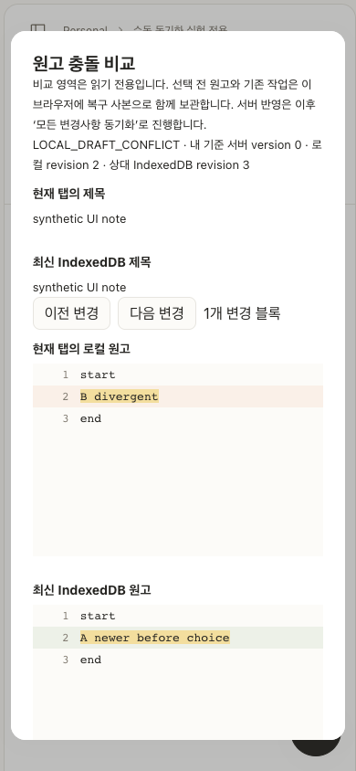

> 최신 정책(2026-10-28): 버전 선택은 제목·본문을 로컬에 원자 확정한 뒤 해당 원고만 즉시 서버 저장·ACK한다. 성공 후 모달을 닫고, 네트워크 실패는 동일 key 재시도, 재409는 최신 비교로 돌아간다. 이미 서버 원고를 채택해 같아진 경우 불필요한 PUT은 생략한다. 제목도 별도 Diff 영역에서 강조한다. 아래의 ‘이후 전체 동기화로 전송’ 설명은 이전 단계 이력이며 현재 동작이 아니다. `2026-10-28-conflict-choice-server-save.md` 참조.

> 2026-10-28 UI 후속 변경: 현재 화면은 충돌 감지 시 자동으로 열리며, 현재 원고와 서버 원고(로컬 CAS이면 다른 탭 원고) 및 각 패널 아래 선택 버튼만 표시한다. 다운로드/이력 파일/재비교/변경 이동/나중에 결정 버튼과 헤더 충돌 목록은 제거했다. Escape/바깥 클릭으로 선택 없이 닫으며, 내부 원자적 복구 사본과 CAS/Outbox 처리는 유지한다. 아래 이전 UI 화면·실측은 최초 구현 검증 이력이다. 현재 검증은 `2026-10-28-conflict-simple-ui.json` 참조.

# 원고 충돌 비교와 안전한 버전 선택

구현 시작 2026-10-27, 최종 검증 2026-10-28. commit/push하지 않는다.

## 사용자 동작

헤더의 **원고 버전 비교**, 로컬 충돌 안내의 **원고 충돌 비교**, 또는 **충돌 원고 목록**에서 비교 화면을 연다. 제목과 본문을 읽기 전용으로 비교한 뒤 내 원고/상대 원고/나중에 결정을 선택한다. 선택 전 원고와 기존 작업의 복구 사본은 IndexedDB commit에 포함된다. 닫기/Escape는 내용을 선택하지 않는다.

**선택은 로컬 확정이다.** 내 원고를 선택하면 새 operationId와 최신 확인 기준의 작업을 준비한다. 서버 전송은 이후 사용자의 **모든 변경사항 동기화** 클릭으로 수행한다. 선택만으로 PUT하거나 서버 ACK 성공으로 표시하지 않는다. 상대 서버 원고를 채택하는 것은 실제 GET snapshot을 로컬 기준으로 삼는 동작이며, 거부된 이전 PUT을 성공 ACK로 꾸미지 않는다.

서버가 명확히 NOTE_NOT_FOUND를 반환한 경우에는 일반 Diff를 표시하지 않는다. 원고를 보관할 폴더를 명시적으로 선택하고 **새 원고로 복구**한다. 새 UUID의 Draft/LocalEntity/NOTE_CREATE를 commit한 후 그 UUID로 이동한다. 원래 UUID는 서버에서 재생성하지 않는다. 변경 없는 로컬 원고도 실제 GET404를 확인하면 실패 PUT 없이 복구할 수 있다.

## 충돌을 구분하는 근거

| 유형 | 근거 | 비교 상대 | 선택 경계 |
| --- | --- | --- | --- |
| LOCAL_DRAFT_CONFLICT | DraftSession의 LocalDraftConflict, 최신 IDB token/revision과 메모리가 불일치 | 최신 IndexedDB Draft | 비교한 token/revision 및 전체 Outbox snapshot 재검증 |
| SERVER_VERSION_CONFLICT | 실제 PUT409의 ErrorCode가 VERSION_CONFLICT로 기록됨 | 새 GET으로 읽은 서버 Note | 선택 직전 GET version/title/content 재검증 + 이후 PUT expectedVersion |
| SERVER_NOTE_DELETED | PUT의 NOTE_NOT_FOUND 기록 또는 실제 GET404 + NOTE_NOT_FOUND, 선택 직전 다시 확인 | 상대 본문 없음 | 새 UUID 복구만 가능 |
| 기타 오류 | IDEMPOTENCY_KEY_REUSED, UUID 충돌, 일반404, FOLDER_NOT_FOUND 등 | 일반 버전 선택 대상으로 취급하지 않음 | 기존 작업 보존·진단 안내 |

NOTE_NOT_FOUND는 현재 서버에서 원고를 찾지 못했다는 계약이다. 일반404나 Workspace 목록에서 보이지 않는다는 사실만으로 삭제를 단정하지 않는다. 누가 삭제했는지까지 추론하지 않는다. 로컬 생성 NOTE_CREATE가 남은 미발행 원고를 서버 삭제로 오인하지 않는다.

`draftDatabase.write`의 token 불일치 또는 요청 revision<=저장 revision 거부는 로컬 데이터 보호다. 서버409와 별개이며 최초 복구 전 쓰기를 막는 Recovery Barrier도 별도다. 변경 전 실증2개는 `2026-10-27-conflict-diff-before.json`에 원고 해시·버전·소스 해시로 기록했다. 실제 같은 origin 두 탭과 별도 persistent profile 두 개를 사용했다.

## 불필요한 충돌은 기존 안전한 재조정을 재사용

기존 DraftSession의 checkpoint는 마지막 성공한 local commit을 뜻한다. 현재 내용이 최신 IDB와 같거나 마지막 commit 후 추가 입력이 없으면 최신 로컬 내용을 채택한다. 추가 입력이 있더라도 최신 IDB의 본문이 checkpoint와 같고 동일 read transaction에서 Outbox 호환성이 검증된 경우에만 metadata-only rebase한다.

같은 본문이라고 inFlight 요청을 삭제하거나 교체하지 않는다. 읽은 본문을 따라가는 경우에도 `serverProtected`를 유지하며 작업 자체는 그대로 둔다. 실제 사용자 선택 경로는 inFlight/불확실한 생성 작업이 있으면 차단한다. 해당 작업의 기존 operationId로 결과를 먼저 확인해야 한다. 로컬 충돌과 서버 terminal 충돌이 동시에 남은 경우에도 로컬 교체를 차단한다. 현재 입력을 파일로 보관하고 최신 저장 본문을 가진 탭에서 서버 충돌을 먼저 정리한 뒤 로컬 내용을 다시 비교한다. 세 버전의 자동 병합은 하지 않는다. 로컬 선택은 온라인이 아니어도 원고별 Web Lock과 IDB CAS로 가능하다. 서버 선택/삭제 복구는 현재 계약상 온라인 확인이 필요하다.

## 비교 snapshot과 선택 fence

`conflictService.inspectConflict`는 해당 noteId를 복구하고 최신 입력을 먼저 로컬 commit한다. 실제 로컬 충돌로 commit할 수 없는 경우에는 메모리를 그대로 비교한다. 기존 retry는 검증된 자동 재조정만 수행한다. `conflictHead`는 Draft/Note Outbox/CreationOutbox를 같은 readonly transaction에서 읽는다.

Preview에는 noteId, 현재 메모리 revision과 제목·본문·기준 버전, 최신 IDB record, 작업 snapshot, 실제 서버 snapshot 또는 확인된 부재 상태가 있다. `headStamp`는 token/revision뿐 아니라 작업 ID·상태·불변 payload·버전·시도 상태를 포함한다. 비교 후 본문은 같더라도 작업 상태가 바뀌면 그 선택을 재사용하지 않는다.

선택 시 순서는 다음과 같다.

1. 현재 메모리 revision과 비교 revision이 같은지 확인한다.
2. 최신 IDB head/작업이 Preview와 같은지 확인한다.
3. 서버 충돌이면 기존 global Web Lock 아래 서버 version/title/content를 다시 읽어 확인한다. local 선택은 별도 원고별 선택 lock을 쓴다.
4. DraftSession의 짧은 선택 fence 아래 `resolveConflict`를 수행한다. repository는 IDB readwrite transaction 안에서 head와 작업을 다시 읽고 전체 stamp 및 메모리 fence를 확인한다.
5. 선택 전 메모리, 저장된 로컬 원고, 비교 상대, 기존 작업을 복구 사본에 보관한다. 서로 다른 세 상태가 있을 수 있어 저장된 로컬 원고도 별도로 보존한다.
6. 로컬 충돌은 미전송 작업에 한해 기존 write/CAS/coalescing 경로를 재사용한다. 서버 충돌은 알려진 terminal VERSION_CONFLICT와 미전송 후속 작업만 보관·교체한다. 새로운 pending UPDATE는 새 UUID와 최신 서버 baseVersion을 사용한다.
7. 전체 commit 성공 뒤에만 Session의 checkpoint/token/revision/화면을 갱신한다. 실패하면 전체 rollback하고 기존 메모리와 작업을 유지한다. commit 직후 더 새 메모리 입력이 도착했다면 이를 별도로 보존하고 다음 정상 CAS commit을 요구한다.

서버 GET과 IndexedDB commit, 이후 PUT을 하나의 분산 transaction으로 만들었다고 주장하지 않는다. 다른 프로필이 그 사이 다시 서버를 바꿀 수 있다. 마지막 PUT의 expectedVersion이 이를 최종 거부한다. 재충돌 시 새 작업도 보존되며, 비교를 다시 열면 최신 서버를 읽는다. 선택 직전 버전 변경은 자동으로 Diff를 갱신하고 다시 확인하게 한다.

## 복구 사본과 데이터 모델

새 테이블·인덱스·DB version·Flyway migration을 추가하지 않았다. Dexie v1~v4의 schema 선언은 기존과 동일하다. 기존 `drafts` 레코드에 optional **conflictHistory** 및 삭제 복구 시 **recoveredAs** 필드만 추가했다. 기존 데이터는 필드가 없어도 정상 읽는다.

각 history 항목은 원인/선택/시간, 현재 탭 원고, 저장된 로컬 원고, 비교 상대, 이전 Outbox/CreationOutbox snapshot을 보관한다. 사용자 선택 결과와 같은 transaction에 기록되므로 사본만 누락되는 부분 성공이 없다. 정상 후속 write는 history를 유지하고 ACK는 기존 record를 펼쳐 보관한다. 새 필드는 읽기 projection `canRebaseLocalEdits`와 달리 실제 저장하는 복구 데이터이며 형식·출처 noteId를 검증한다.

보관된 항목은 비교 화면에서 이전 내 원고/IndexedDB 원고/상대 원고를 txt로 내려받을 수 있다. 오래된 operationId를 자동 활성화하거나 다른 payload에 재사용하지 않는다. 삭제 복구는 새 record/새 UUID/NOTE_CREATE를 원자적으로 만들고, 옛 record를 삭제하지 않고 새 ID를 연결한다. 옛 ID를 다시 편집·전송하지 못하게 write에서 차단한다.

같은 브라우저 저장소 안의 사본은 외부 백업이 아니다. 저장소 삭제·회수와 quota의 한계가 있고, 사본 자동 만료/정리도 이번에 넣지 않았다. 선택이 반복되면 저장량이 늘고 실패 시 transaction이 보존된 기존 데이터로 rollback한다. 구버전 앱 코드와 새 코드의 혼용은 보장 범위 밖이다. 이전 write 구현은 새 optional 필드를 모를 수 있으므로 개발 환경은 탭을 모두 갱신하고, production의 기존 ‘모든 앱 창 종료 후 SW 적용’ 정책을 유지한다. 이 혼용 위험은 코드 분석으로 식별했으며 운영 유실을 재현했다고 주장하지 않는다.

## Diff 알고리즘과 렌더링

- 줄 배열의 동일 prefix/suffix를 먼저 제거하고 작은 변경 구간에 bounded LCS를 적용한다. `(n+1)*(m+1)>200,000`이면 해당 구간을 coarse line pairing으로 표시하고 UI에 알린다. Git의 Myers 알고리즘을 구현했다고 주장하지 않는다.
- coarse에서도 각 패널의 모든 원문·줄 순서·빈 줄을 그대로 유지한다. 매칭 정밀도가 낮아질 뿐 자동 병합·삭제·텍스트 가공을 하지 않는다.
- changedRange는 공통 문자 prefix/suffix 사이를 강조한다. 의미 단위 문장 병합이나 정확한 단어 편집거리라고 표현하지 않는다. Unicode code point를 사용하며 매우 긴 줄은 문자 분석을 생략하고 줄 전체를 강조한다.
- 계산은 native module Worker에서 수행하고 이전 Worker 결과는 unmount/교체 시 폐기한다. 읽기 전용 패널은 줄 높이24px의 가상 스크롤로 양쪽 합계 최대180개 줄 DOM만 렌더링한다. 대응하는 줄의 세로 스크롤 및 이전/다음 변경 블록 이동을 동기화한다. 긴 줄은 가로 스크롤로 읽는다.
- 제목은 별도로 양쪽 비교·강조한다. 모바일은 두 패널을 세로로 배치한다. 처음 열면 제목에 focus하여 모바일에서도 상단을 유지한다. Radix focus trap, Escape/나중에 결정, 원래 버튼 또는 대체 헤더 버튼으로의 focus 복귀를 확인했다.
- ConflictDialog는 lazy import이며 Worker/JS는 기존 PWA precache 대상이다. API나 원고 본문을 SW cache에 추가하지 않았다. 실제 offline production 두 탭의 Diff Worker 실행과 선택 commit도 검증했다.

## 실제 측정·검증

최종 수치·환경·원고 해시는 verification의 conflict-diff-performance / after / ui / pwa / auto-reconcile 및 최종 summary를 따른다. 성능은 production preview(Service Worker를 막은 별도 측정 context), Chrome156,1440×1000(모바일390×844), 크기별 cold context 한 번씩의 표본이다. Worker 순수 계산, Worker 시작·전달 포함, 모달 로딩·IDB·mock GET·첫 변경 이동 포함 시간은 서로 다른 지표다. p95/성능 개선률/Safari 결과를 만들어 보고하지 않는다.

최종 production 측정(각 조건 1회, 동일 기기 표본):

| 줄 수·조건 | 문자 수 | Worker 계산 ms | 시작·전달 포함 ms | 모달·첫 변경 이동 완료 ms | 줄 DOM |
| --- | ---: | ---: | ---: | ---: | ---: |
| 1,000 · single | 36,889 | 0.6 | 6.9 | 934 | 180 |
| 10,000 · single | 378,889 | 3.1 | 13.7 | 607 | 180 |
| 50,000 · single | 1,938,889 | 11.7 | 46.1 | 899 | 180 |
| 10,000 · all | 378,889 | 2.8 | 19.0 | 568 | 180 |
| 1 · long | 200,000 | 0.2 | 5.9 | 1068 | 2 |

모달 측정에는 첫 변경 버튼 클릭과50ms 대기도 포함된다. 전체가 변경된10,000줄은 coarse 표시이며 본문 양쪽의 원래 줄은 보존한다.20만 자 한 줄도 확인했다. 무제한 길이·모든 기기의 성능을 보장하지 않는다. CPU 모델은 sandbox sysctl 제한으로 수집하지 못했다.

검증: Node162개, backend35개, 실제 충돌 처리14개, UI4개 묶음, 자동 재조정9개, production Workspace18개, production PWA11개, 기존 mock browser12개 suite 통과. build/TypeScript/lint 통과. 서로 겹치는 회귀를 독립 테스트 수로 합산하지 않는다. [최종 검증 요약](../verification/2026-10-28-conflict-diff-summary.json), [Workspace 회귀](../verification/2026-10-28-conflict-workspace-regression.json).

## 직접 재현

기존 개발 원고 대신 격리 lab을 사용한다. `python3 scripts/manual-sync-lab.py --conflicts`는 backend/Workspace/충돌 선택/UI/자동 재조정/기존 browser/PWA를 한 번에 실행하는 진입점이다. 이번 검증은 같은 구성요소를 기존 `--serve` lab에서 각각 실행했고, 결합 명령 전체를 재실행했다고 주장하지 않는다.

1. `python3 scripts/manual-sync-lab.py --serve` 실행. 출력 origin/API/fixture를 사용한다. 기본 연구 포트는 Vite25175/API18766/PostgreSQL25442다.
2. 로컬 충돌은 같은 origin 두 탭에서 같은 원고를 열고 둘 다 수정한 뒤 저장하게 한다. 성공 여부는 타이머에 따라 달라지므로 특정 탭의 승리를 가정하지 않는다. 패한 탭에서 로컬 충돌 비교를 연다.
3. 서버 충돌은 Chrome 프로필을 분리한다. 두 프로필이 버전0을 읽은 뒤 각자 편집하고 B에서 전체 동기화, A에서 전체 동기화한다. A의 실제 PUT409 VERSION_CONFLICT와 conflict 작업을 확인한다.
4. 비교 후 다른 탭/프로필이 다시 수정해 token/version을 바꾼 다음 선택하면 적용이 중단되고 최신 비교가 필요하다.
5. 내 원고 선택 후 새 operationId/expectedVersion을 확인하고 전체 동기화한다. 실제 PUT200/ACK 뒤만 활성 작업이 제거된다. 상대 원고 선택 후에는 이전 내 원고 파일을 내려받아 확인한다.
6. 삭제 복구는 lab의 합성 원고만 삭제한다. GET/PUT NOTE_NOT_FOUND 확인 뒤 복구 폴더를 선택하고 새 UUID로 복구한다. 옛 UUID GET404와 새 UUID 생성 ACK를 확인한다.
7. 실행 가능한 하네스: conflictResolutionLive(기본 after, before는 명시 환경변수), conflictResolutionUi, conflictDiffPerformance, 기존 workspaceSyncLive/pwaOffline. 실제 API 하네스는 lab DB 이름 및 개발 포트가 아님을 검사한다.

## 포트폴리오에 쓸 수 있는 근거

1. **실제 재현한 local/server 충돌과 UX 부재 개선**: 서로 다른 일관성 경계(CAS vs expectedVersion)를 분리하고, 거부를 없애는 대신 비교·선택·보관 경로를 설계했다.
2. **TOCTOU와 부분 성공 위험 방어**: 비교 후 재수정·quota·ACK 실패를 격리 테스트로 주입했다. 사용자 원고 유실이 과거 실제 발생했다고 표현하지 않는다.
3. **불변 요청과 사용자 선택의 공존**: terminal conflict snapshot을 보관하고 최신 version의 새 키를 생성했다. inFlight는 덮어쓰지 않고 동일 키로 먼저 결과를 확인한다.
4. **긴 원고 Diff의 비용 제한**: 기존 Diff 성능 버그를 고쳤다고 쓰지 않는다. 새 기능의 bounded 계산/Worker/가상 스크롤 결정과 실제 길이별 수치로 설명한다.
5. **접근성 검증 중 발견한 구현 문제**: 프로그램으로 연 Radix 모달의 focus 복귀를 명시적으로 구현했다. 초기 Escape 대기 오류는 하네스의 await 누락이므로 제품 버그와 구분한다.

실제 사용자 원고·개발 DB·운영 설정은 변경하지 않았다. 인증, 자동 동기화, 강제 overwrite, CRDT, 자동/문장별 병합은 구현하지 않았다.

### 테스트 실행 환경 주의

`tests/browser/helpers/onlineChrome.cjs`는 연구 context의 초기 온라인/오프라인 조건을 CDP로 명시한다. OS 네트워크 설정이나 제품 `navigator.onLine`/Web Lock 가드를 고치지 않는다. 후속 scenario의 `context.setOffline(true)`는 그대로 적용된다. 직접 Node로 실행할 때는 실제 Playwright 위치를 SEAM_NOTE_PLAYWRIGHT_BASE, 이 helper 파일을 SEAM_NOTE_PLAYWRIGHT_MODULE로 지정한다. 오래 실행하며 HMR 이력이 쌓인 Vite에서 module 객체에 fault를 주입하는 대신, 기존 mock fault-injection suite는 소스 수정 없는 새 origin/cache에서 실행했다.

## 실제 UI 검증 화면

아래 화면은 합성 원고의 격리 Chrome 검증이며 사용자 원고가 아니다.

