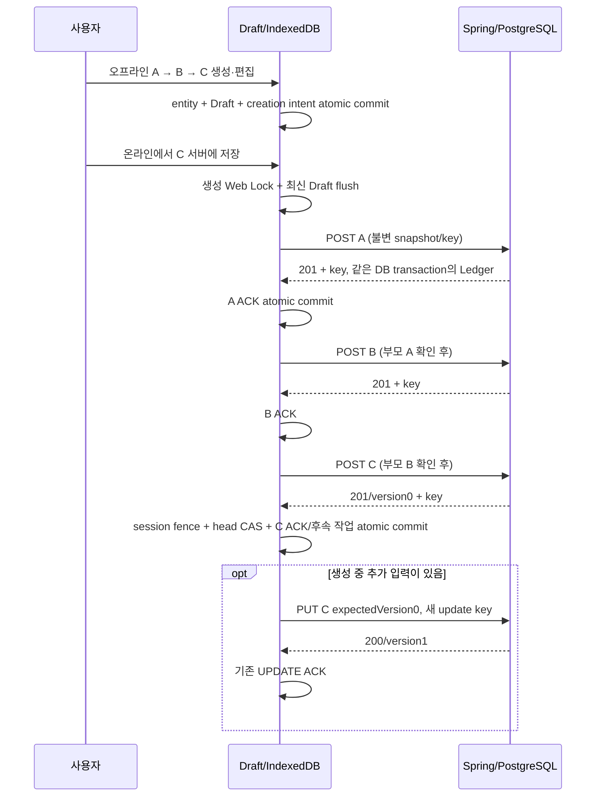

# 오프라인 폴더·노트 생성과 명시적 서버 반영

## 사용자 동작

온라인/오프라인 모두 기존 `+` 메뉴에서 로컬 생성한다. 폴더는 트리의 생성 위치에서 바로 이름을 입력하며 Enter/포커스 이동으로 확정한다. Escape는 저장 전 입력을 취소한다. `새 폴더`는 현재 위치 아래, `새 최상위 폴더`는 최상위에 입력 행을 연다. 별도 생성 모달은 없다. 이미 생성한 폴더의 오프라인 이름 변경은 제공하지 않는다. 노트는 현재 생성 위치의 folderId와 새 UUID로 빈 Draft를 만들고 `/notes/{id}`로 이동한다. 로컬 트리에는 `로컬` 표시가 있고, 편집은 기존 DraftSession을 사용한다.

온라인 복귀만으로 POST/PUT하지 않는다. 원고의 `서버에 저장`은 필요한 부모 폴더→원고 생성→필요한 후속 수정 순서로 처리한다. 원고 없는 폴더도 사이드바에서 선택한 뒤 `폴더 서버에 저장`으로 자신과 필요한 조상만 반영할 수 있다. 관련 없는 원고/폴더를 일괄 전송하지 않는다.

## IndexedDB v4와 Workspace 관계

v1/v2/v3 선언과 데이터를 변경하지 않고 두 table을 추가한다.

```ts
version(4).stores({
  drafts: '&noteId',
  outbox: '&operationId, noteId, status',
  workspace: '&key',
  localEntities: '&id, kind',
  creationOutbox: '&operationId, entityId, status',
})
```

- `workspace`: 성공한 서버 목록과 확인된 생성 결과의 metadata cache다. 본문은 포함하지 않는다.
- `localEntities`: 클라이언트 UUID, kind, parentId/folderId를 포함한 Folder/NoteSummary, confirmed/confirmedAt이다. version0만으로 서버 존재를 판단하지 않는다. `confirmed=false`가 미생성 상태다.
- `creationOutbox`: `FOLDER_CREATE`/`NOTE_CREATE` 불변 요청 snapshot과 UUID operationId/status/attemptedAt이다. NOTE_CREATE에는 snapshot의 localRevision이 있다. expectedVersion은 아직 없다.
- 기존 `outbox`: 서버에 존재하는 Note의 `NOTE_UPDATE`다. 기존 검증기/요청 구조를 깨지 않도록 생성 작업은 별도 typed queue에 둔다. UI/오케스트레이터에서 두 큐를 합쳐 전송 가능 여부와 남은 작업을 계산한다.

`loadWorkspace`는 서버 GET을 먼저 저장한 뒤 미확정 localEntities를 merge한다. 같은 ID의 서버 데이터가 있어도 pending local entity는 덮어쓰지 않는다. 생성 ACK 직후 오래된 GET 때문에 항목이 사라지지 않도록 confirmedAt보다 먼저 시작한 snapshot에는 성공 receipt를 보충한다. 이후 실제 GET이 새로 관측한 서버 목록을 우선한다. receipt는 요청/ACK 검증에 쓰며 삭제/이동의 전역 동기화 프로토콜은 아니다.

서버 목록이 없더라도 로컬 생성 항목이 있으면 빈 server base 위에 복원한다. 서버 GET 실패를 로컬 생성 삭제로 취급하지 않는다. IndexedDB를 읽지 못할 때는 데이터를 추측해서 덮지 않고 안내한다. 유효한 live 서버 응답은 로컬 merge 오류만으로 가리지 않는다.

## 원자적 로컬 생성과 편집

### Folder

`createLocalFolder`는 UUID/이름/부모를 검증하고 server cache와 local parent를 확인한다. sibling의 최대 provisional sortOrder+1을 정한다. local entity와 FOLDER_CREATE를 같은 readwrite transaction으로 commit한다. 기존 Draft/Note/Folder/작업 ID와 충돌하면 중단한다.

### Note

`createLocalNote`는 local entity, 초기 Draft(storageToken/localRevision1), NOTE_CREATE를 같은 transaction으로 commit한다. 하나라도 실패하면 전부 rollback한다. 로컬 version0은 서버 version이 아닌 초기 placeholder이며, server-create ACK 전에는 PUT을 허용하지 않는다.

`DraftRepository.write`는 기존 token/revision CAS를 먼저 검사한다. 미생성 Note이면 다음처럼 처리한다.

- pending NOTE_CREATE는 현재 title/content/revision의 **새 operationId**로 대체한다. 같은 키의 payload를 바꾸지 않는다.
- inFlight/conflict NOTE_CREATE는 보존하고 최신 Draft만 저장한다. NOTE_UPDATE를 만들지 않는다.
- 생성 ACK 후 confirmed Note는 기존 NOTE_UPDATE/병합 정책으로 돌아간다.

cold URL에서 Workspace가 아직 로컬 여부를 읽기 전에도 Note Query가 local marker를 검사한다. 미생성 원고에 서버 detail GET을 보내지 않는다. 실제 서버 NoteResponse와 local Draft를 동일 객체로 취급하지 않으며 상세 Query에 가짜 성공 응답을 넣지 않는다.

## 서버 생성 멱등성

기존 POST는 클라이언트 UUID를 받지만 같은 UUID 재요청을 `DUPLICATE_ENTITY_ID`409로 거부했다. 수정 Ledger가 생성에 적용된다고 가정하지 않고 새 Flyway `V4__creation_idempotency.sql`과 CreationLedger/IdempotentCreations를 추가했다.

| 요청 | 처리 |
| --- | --- |
| 같은 key/type/id/payload | 원래201 JSON과 Idempotency-Key/Location 재사용 |
| 같은 key, 다른 type/id/payload |409 IDEMPOTENCY_KEY_REUSED |
| 다른 key, 이미 존재하는 UUID |409 DUPLICATE_ENTITY_ID, 원본 유지 |
| 유효하지 않은 key 또는 key를 보내면서 client id 누락 |400 |
| key 없는 기존 클라이언트 | 기존 생성 계약 유지, UUID 재시도는 멱등 보장 없음 |

생성 호출과 Ledger insert는 하나의 READ_COMMITTED Spring/PostgreSQL transaction이다. entity flush 후 Ledger insert가 실패해도 생성 전체를 rollback한다. 기존 NoteUpdateLedger의 key lock을 공유하고 양쪽 Ledger의 key 존재를 검사해 생성·수정 사이의 재사용도 직렬화/거부한다. 기존 Note @Version, expectedVersion, FolderStructureLock을 유지한다.

Ledger에는 FK/TTL 삭제 job이 없고 성공 결과를 무기한 보존한다. key를 재활용하지 않는다. 용량·개인정보 보존 정책은 인증/정리 정책 도입 때 별도로 설계해야 한다. 서버 sortOrder는 서버의 sibling max+1이고 생성 version은0이다. 로컬 순서는 임시 값이며 ACK의 실제 sortOrder로 갱신한다.

## 수동 반영 순서와 ACK



`creationChain`은 local parent를 역추적하며 cycle/빠진 작업을 검사하고 root-first 순서를 만든다. `claimCreation`도 직접 parent 상태를 다시 검사하므로 잘못된 호출로 자식을 먼저 보내지 못한다. 전송 snapshot은 pending→inFlight 이후 수정하지 않는다.

`creation-sync` Web Lock은 두 탭의 생성 전송을 동시에 진행하지 않게 한다. 대기 호출을 자동 예약하지 않고 중단한다. 부모가 실패하면 loop가 즉시 끝나며 자식 Draft/entity/작업은 그대로 남는다. 서버 Ledger는 탭 잠금을 우회한 중복 요청도 방어한다.

Folder ACK는 응답 ID/parent/name/version과 저장된 inFlight snapshot을 확인한 뒤 local marker/Workspace/작업 제거를 한 transaction에 묶는다. Note ACK는 기존 `DraftSession.acceptServerAck` fence를 재사용한다. 저장 head CAS 뒤 현재 본문은 유지하며 생성 snapshot/version0을 기준으로 삼고, marker 확정/Workspace 보충/성공 작업 제거/필요한 NOTE_UPDATE 생성을 한 transaction에서 처리한다. fence 중 새 메모리 입력도 유지해 다시 로컬 저장한다.

성공이 확인된 작업만 제거한다. ACK 실패 시 inFlight는 남으며 기존 로컬 저장 재시도로 상태를 확인한 뒤 같은 key를 재시도한다. 불확실 작업을 새 ID로 대체하지 않는다. 생성 후 후속 PUT은 기존 expectedVersion/멱등성 경로를 이용하고, 그 PUT 도중 더 생긴 입력은 다음 클릭 대상으로 남긴다. 자동으로 끝없이 drain하지 않는다.

## 실패 복구

- 부모503/네트워크 실패: 부모 inFlight와 자식 pending 유지. 다음 명시적 클릭은 같은 부모 key부터 재확인한다.
- 원래201 응답 유실: 서버에는 entity+Ledger가 존재한다. 같은 key/body로201을 재사용하고 ACK를 진행한다.
- UUID/key 충돌409: conflict 상태로 보존하고 전송 중단. 로컬 원고를 서버 데이터로 대체하지 않는다.
- 부모404: 미생성 Note 자체의404로 잘못 영구 차단하지 않는다. 부모 오류를 알리고 관련 생성 작업을 보존한다.
- 생성 ACK rollback: marker/Workspace/Draft/작업 제거가 부분 성공하지 않는다. 서버 성공과 로컬 ACK를 구분해 보존한다.
- 다른 탭이 Draft head 변경: CAS/fence가 ACK를 거부한다. 강제로 token을 맞추지 않는다.
- 같은 탭 중복 클릭: ref, 생성 Web Lock, 기존 Note Web Lock을 유지한다.

## 재현과 결과

```sh
python3 scripts/manual-sync-lab.py --creation
pnpm --dir frontend build
pnpm --dir frontend lint
pnpm --dir frontend test
```

생성 실증은 production app shell을 임시 HTTP proxy로 제공하고 실제 임시 Spring/PostgreSQL에 연결한다. Chrome persistent profile을 종료 후 offline 새 프로세스로 열고 local entity/본문을 확인한다. 게이트웨이502로 원래 성공 응답 유실을, IndexedDB native API fault로 atomic rollback을 주입한다. 실제 개발 DB/profile은 사용하지 않는다.

[실제 생성10개 결과](../verification/2026-10-26-offline-creation-results.json), [기존 실제 수정10개](../verification/2026-10-26-offline-creation-update-results.json), [PWA 회귀](../verification/2026-10-26-offline-creation-pwa-results.json), [파일별 순서·전체검증](../worklogs/2026-10-26-offline-creation.md)을 참고한다.

서버 자동 동기화/오프라인 이동삭제이름변경/충돌 병합/수동 정렬/인증은 구현하지 않았다. PWA와 IDB는 동일 origin/profile에 의존하고 브라우저 회수/미commit 입력 한계는 유지한다. Safari/OS 설치 UI는 미검증이다. 이전 PWA의 manifest/precache/waiting 정책은 그대로다.
