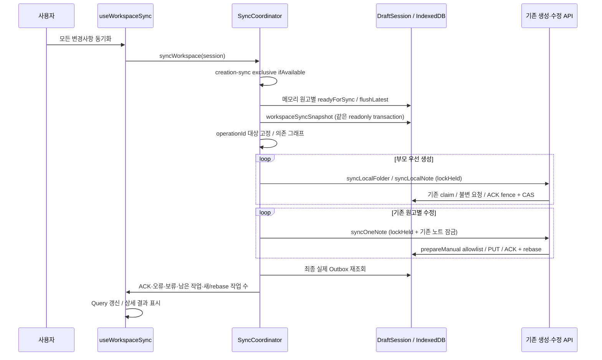

# Workspace 전체 수동 동기화

## 범위와 기존 동작

기존 `서버에 저장`은 useManualSync가 selected noteId에 대해 syncLocalNote → syncOneNote를 한 번 실행했다. 생성 원고의 필요한 부모만 foldersFor로 먼저 생성하며, 형제 폴더나 다른 원고를 스캔하지 않았다. 폴더 저장도 선택된 폴더의 조상 chain만 처리했다. 실패가 아니라 당시 개별 저장 계약이다.

새 버튼 `모든 변경사항 동기화`는 선택 원고/폴더와 무관하다. 자동 online listener/재시도/백그라운드 PUT은 없다. 기존 두 Outbox를 논리적으로 함께 처리하며 DB는 여전히 Dexie v4, 서버는 기존 생성/수정 Ledger와 expectedVersion 계약이다.

개별 원고 저장 버튼과 결과 패널은 제거했다. 선택 원고만을 위한 useManualSync는 AppLayout에서 연결하지 않으며, 기존 syncOneNote/생성 ACK 엔진은 전체 동기화가 재사용한다. 폴더의 기존 단독 저장 기능은 이번 변경 범위 밖이다.

## 호출 순서

서버 성공 응답은 HTTP body/operationId/version을 기존 검증 함수로 검증한 뒤 ACK한다. 서버 DB 성공과 IndexedDB ACK는 서로 다른 transaction이므로 응답 유실·ACK 실패는 성공으로 간주해 작업을 버리지 않는다. 전송 성공을 새로 구현하지 않고 기존 syncLocalFolder/syncLocalNote/syncOneNote와 저장소를 재사용한다.

## 상태 전이와 ACK 선행조건

| 작업 | 전송 전 | 재시도/ACK |
| --- | --- | --- |
| FOLDER_CREATE | localEntities 폴더/부모 관계 확인, 부모 confirmed, pending→inFlight | 같은 operationId/payload 재시도. 성공 응답과 기존 불변 snapshot 확인 뒤 entity/Workspace/작업 제거 원자 ACK |
| NOTE_CREATE | 원고 복구/flush, 부모 confirmed, pending→inFlight | DraftSession fence·현재 token/revision CAS, 생성 ACK/version0 기준 재설정, 추가 입력 보존·후속 UPDATE 생성 |
| NOTE_UPDATE | 원고 복구/flush, prepareManual의 token/revision/expectedVersion 검증 | uncertain inFlight 우선, 동일 key/payload. ACK와 기준 version 변경·후속 rebase 원자 처리 |
| conflict | 전송 제외 | 작업/원고 보존, 사용자 확인 필요 |

새 allowlist는 claim transaction 안에서 검사한다. 대기 중 pending 작업이 새 편집으로 coalesce돼 operationId가 바뀌면 이번 실행에서 다른 snapshot을 대신 보내지 않는다.

## 실행 범위

1. 이 AppLayout의 메모리 Draft만 flush 가능하다. 각 원고별 성공 여부를 확인한다. 실패 원고만 제외하고 관련 없는 작업은 계속한다. 다른 탭/프로필의 미commit 메모리는 읽거나 flush하지 않는다.
2. barrier 뒤 snapshot을 처리 대상으로 정의한다. 누르는 순간 아직 메모리에 있던 입력은 이 단계까지의 안전한 commit에 포함된다. 지속 입력 때문에 기존 flushLatest가50회 안에 안정화되지 못하면 해당 원고를 제외한다.
3. 원고를 선택하지 않았어도 IndexedDB에 commit된 원고는 readyForSync로 복구하고 동일 Session에 등록한다. URL이나 에디터 선택을 바꾸지 않는다.
4. 폴더 parent→child→note 순서로 처리한다. 누락 엔티티/부모·잘못된 형태·중복 생성·순환은 보류한다. 실패 부모의 종속 작업만 보류한다.
5. 기존 UPDATE는 노트별로 처리한다. 이미 uncertain 선행+pending 후속이 클릭 시 존재했다면 선행 ACK 뒤 새 key로 rebase된 후속을 최대1회 더 처리할 수 있다. 단, 현재 제목/본문이 클릭 snapshot과 같을 때만 가능하다. 새 입력이 있으면 후속을 남긴다.
6. 이번 CREATE의 ACK로 생긴 UPDATE는 최대1회 처리한다. 그 UPDATE 전송 중 추가 입력은 다음 실행 대상으로 남긴다. 무한 drain하지 않는다.
7. 실제 최종 read가 실패하면 remaining=undefined/확인 불가이다. 빈 큐나 완료로 추정하지 않는다.

## 잠금과 교착 방지

기존 `seam-note:creation-sync` global Web Lock을 전체 실행 동안 공유한다. 개별 원고의 create+update도 이 잠금을 한 번만 잡고 내부 함수를 lockHeld로 호출한다. 개별 폴더 저장/삭제와 로컬 폴더·노트 생성 adapter도 같은 잠금에 참여한다. coordinator 내부에서는 global lock을 재획득하지 않는다. 원고별 manual-sync:{id} 잠금과 DB CAS/expectedVersion은 그대로 유지한다.

동기화 중 원고 제목/본문의 메모리·IndexedDB 저장은 계속 가능하다. 새 폴더/노트 생성 commit은 global lock 뒤로 대기할 수 있다. 긴 요청의 비용을 감수하고 생성·삭제·전송 경쟁을 직렬화한 선택이다. 동일 origin의 최신 코드 탭에 적용되며 다른 프로필/장치는 서버 멱등성·expectedVersion이 보호한다. 구버전 탭까지 global 참여를 강제하지는 못하나 기존 노트 잠금/CAS/서버 보호를 제거하지 않는다.

## 실패 격리와 재시도

| 결과 | 보존/진행 정책 |
| --- | --- |
| VERSION_CONFLICT / IDEMPOTENCY_KEY_REUSED | 기존 conflict 상태로 보존, 다른 원고 진행 |
| NOTE_UPDATE404 + NOTE_NOT_FOUND | failureCode=NOTE_NOT_FOUND와 기존 conflict 상태로 격리. 자동 재생성 없음. 이후 명시적 전체 실행도 다시 PUT하지 않고 확인 필요 표시 |
| CREATE404 + FOLDER_NOT_FOUND | 누락된 부모 확인 필요로 격리. 원고 삭제라고 해석하지 않음 |
| 일반HTTP404 | 삭제로 단정하지 않음. 원래 작업/키 유지, 기타 실패 표시 |
| 401/403 | 권한 확인 안내 후 남은 작업 보류 |
| 0/5xx/timeout | 원래 inFlight/key/snapshot 유지. 연속2건이면 요청 확산을 멈추고 나머지 보류. 중간 ACK 성공은 연속 실패 수를 초기화 |
| ACK 실패 | 기존 원고/작업 보존. 로컬 상태를 복구한 뒤 같은 key로 서버 성공 결과 재확인 |
| 로컬 flush/복구 실패 | 그 원고만 제외, 안전한 독립 작업 진행 |
| 저장소 read 실패 | 빈 큐로 처리하지 않음. initial read 실패는 전송하지 않고 오류, final read 실패는 남은 수 확인 불가 |

failureCode는 conflict 상태의 오류 분류 metadata이며 불변 요청 snapshot에 포함되지 않는다. 기존 object store의 비인덱스 선택 속성을 추가했으므로 새 migration/table이 필요 없다. 이전 레코드에 속성이 없어도 읽을 수 있다. Tombstone이나 충돌 해결 엔진을 도입한 것은 아니다.

## UI와 집계

AppHeader의 전역 섹션에서 버튼/실제 두 Outbox 건수/미commit 메모리 원고 수를 표시한다. 빈 큐에서 명시적 실행도 허용해 ACK0/남은0을 확인할 수 있다. 조회 실패는 작업 수 확인 불가다. 건수 표시는 native count만 사용해 매 입력마다 전체 원고 본문을 복제하지 않는다. 이 효과의 실제 latency는 미측정이다.

ACK callback 이후의 operationId만 성공 Set에 넣는다. final DB에 실제 남은 개수는 별도로 세며 성공 건수를 거기서 빼거나 더하지 않는다. `새로 기록·재조정된 작업`은 초기 snapshot에 없던 final operationId 수로, 사용자 입력뿐 아니라 정상 rebase도 포함한다. 성공 수와 남은 수의 합을 초기 수와 같다고 주장하지 않는다. 일부 ACK 후 새 입력의 저장 실패도 ACK 성공과 별도 로컬 실패로 표시한다.

결과는 `마지막 실행` 기준이며 현재 미동기화 건수는 별도로 갱신한다. 충돌/확인 필요/보류/네트워크/기타 실패/로컬 실패/남은 작업을 구분하고 원고 제목과 함께 상세 안내한다. 실패가 남아 있을 때 전체 완료라고 표시하지 않는다. 개별 원고 저장 버튼과 결과 패널은 제거했으며 기존 엔진만 재사용한다.

## 개발 환경 재현

합성 원고를 사용한다. 온라인/오프라인에서 + 메뉴로 폴더·원고 여러 개를 만들고 여러 원고를 편집한다. 로컬 저장 상태를 확인한 뒤 온라인에서 `모든 변경사항 동기화`를 누른다. Network의 `/api/folders` POST → `/api/notes` POST → `/api/notes/{id}` PUT과 Idempotency-Key/expectedVersion을 확인한다. IndexedDB 두 Outbox에서 성공 작업만 제거되는지, 서버 GET과 Ledger에서 같은 operationId가 한 번만 적용됐는지 확인한다. 온라인 복귀/새로고침만으로 POST/PUT하지 않는다.

격리 전체 검증은 `python3 scripts/manual-sync-lab.py --workspace`다. 개발15439/18765/5173을 거부하고 임시 PostgreSQL DB·Spring18766·Vite25175·별도 production origin/Chrome persistent profiles를 사용한다. 결과는 별도 docs/verification 파일에 기록하며 과거 검증 결과를 덮어쓰지 않는다.
