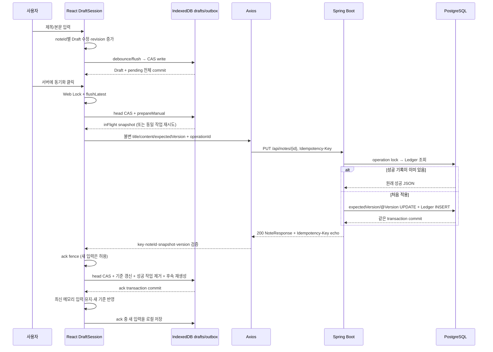
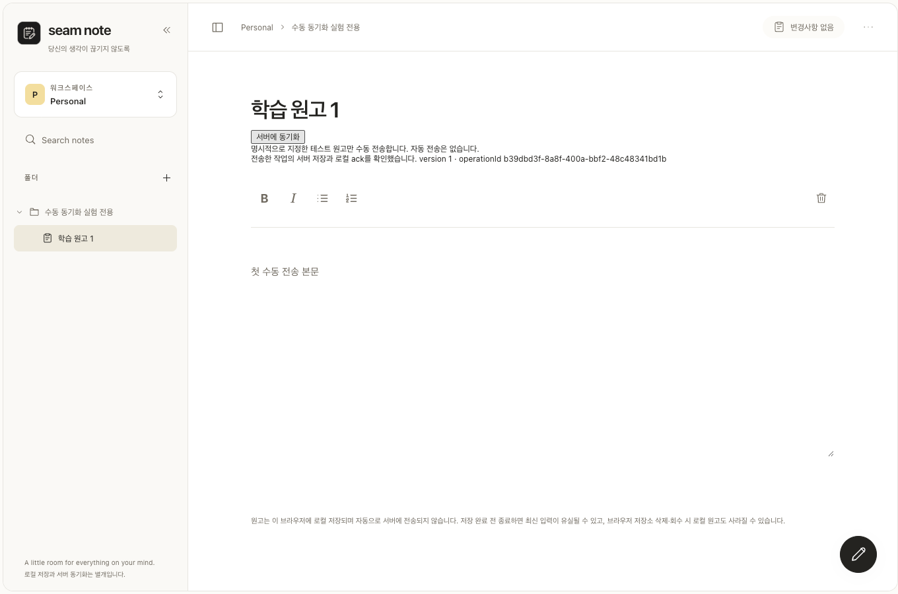

# Seam Note 원고 한 건의 전체 저장 흐름

## 이후 제품 UX 변경

이 문서는 최초 테스트 노트 수직 통합의 실증 기록이다. 이후 모든 정상 원고에서 상단 상태 옆 `서버에 저장` 버튼을 사용할 수 있도록 변경했다. DEV/실험 UUID/env 제한은 제거했으며 별도 실험 DB는 제품 사용에 필요 없다. 최신 버튼 위치·활성 조건·실패 처리는 [일반 수동 저장 계약](../design/manual-server-save.md)을 따른다. 아래 테스트 UUID/실험 명령과 당시 수치는 역사적 검증 기록으로 보존한다. 현재 핵심 함수 이름은 `syncOneNote`다.

## 최초 통합 당시 실제로 연결한 범위

**React Draft → IndexedDB Draft/Outbox → 버튼 클릭 → Axios PUT → Spring Boot → PostgreSQL Note/Ledger → IndexedDB ack → React 기준 갱신**을 연결했다. 지정한 실험 노트 한 건에만 버튼을 제공한다. 자동 전송, 온라인 복귀 시 재시도, 충돌 자동 병합은 없다. 한 번 클릭하면 Outbox 작업 **하나**를 처리한다. 전송 중 새 편집이 생기면 다음 작업을 보존하고 다시 클릭해야 전송한다.

2026-10-26 실측은 새 PostgreSQL 클러스터의 `seam_note_manual_lab`과 별도 Vite origin에서 진행했다. 사용자 DB `15439`, 서버 `18765`, 프론트 `5173`의 원고를 PUT하지 않았다. 실제 실행 기록은 [JSON](../verification/2026-10-26-manual-sync-results.json)과 [작업 이력](../worklogs/2026-10-26-manual-sync.md)에 있다.

## 직접 실습하는 방법

저장소 루트에서 실행한다. Java21, 기존 pnpm 의존성, PostgreSQL의 initdb/pg_ctl/createdb/psql이 필요하다. 기존 DB를 재사용하지 않고 매번 새 임시 클러스터와 노트를 만든다.

```sh
python3 scripts/manual-sync-lab.py --serve
```

콘솔에 나오는 **Lab note URL**을 Chrome에서 연다. 기본 실험 포트는 프론트25175/API18766/DB25442다. 다른 서비스가 해당 포트를 사용하면 스크립트가 중단한다. 종료는 Ctrl-C다. 전용 프로세스 그룹과 임시 PostgreSQL만 정리하며 기존 개발 서버는 종료하지 않는다. 임시 DB 파일·로그는 출력한 /private/tmp 디렉터리에 남아 조사할 수 있다.

자동 검증은 `--serve` 없이 실행한다.

```sh
python3 scripts/manual-sync-lab.py
```

자동 검증은 로컬 Chrome과 Playwright Node 모듈도 필요하다. 스크립트의 기본 모듈 경로는 이 개발 환경의 Codex runtime이며, 다른 환경에서는 `SEAM_NOTE_PLAYWRIGHT_MODULE`에 설치된 Playwright 모듈의 절대 경로를 지정한다. `--serve`만 사용할 때는 이 브라우저 검증 의존성을 사용하지 않는다.

이는 **테스트 코드가 버튼을 클릭**하는 검증 명령이다. 제품의 자동 동기화 엔진은 아니다. 별도 JUnit DB와 실제 수직 통합용 DB를 만들고, 검증 뒤 전용 서버를 종료한다. 종료된 검증 URL은 접속할 수 없으므로 직접 실습에는 `--serve`를 사용해야 한다.

수동 버튼은 다음 조건을 모두 만족할 때만 나타난다.

- Vite 개발 모드 (`import.meta.env.DEV`)
- `VITE_MANUAL_SYNC_LAB=1`
- 선택 noteId가 `VITE_MANUAL_SYNC_NOTE_ID`의 유효한 UUID와 정확히 일치

스크립트가 새 노트를 만든 뒤 이 값을 전용 Vite에만 설정한다. 일반 개발 설정의 기본값은 비활성이다. URL 파라미터만으로 기능을 켤 수 없다. 이 gate는 학습용 범위 제한이지 서버 인증·권한 제어가 아니다. 임의로 기존 원고 ID를 설정해 사용하지 않는다.

## 각 계층의 역할

| 계층 | 담당하는 상태/책임 | 이것만으로는 보장하지 않는 것 |
| --- | --- | --- |
| React Draft | 현재 입력, 노트별 제목·본문, dirty, 작성 기준 | 메모리만으로는 새로고침 복원 불가 |
| Dexie/IndexedDB drafts | 마지막으로 commit한 로컬 원고, baseVersion, localRevision/token | 서버 저장·브라우저 저장소 회수 방지 |
| IndexedDB outbox | 전송할 불변 snapshot, operationId, pending/inFlight/conflict | 큐 기록만으로 HTTP가 실행되지는 않음 |
| Axios | 명시적 PUT과 응답/오류 전달 | timeout으로 서버 미적용을 증명할 수 없음 |
| Spring Boot | 요청 검증, expectedVersion/@Version, 멱등 성공 재사용 | 클라이언트의 최신 편집이나 로컬 ack 상태 |
| PostgreSQL | Note와 성공 Ledger의 같은 transaction commit | 클라이언트가 성공 응답을 받았다는 사실 |
| 로컬 ack | 확인된 작업 처리와 다음 작성 기준 갱신 | 그 이후 새 편집까지 자동 서버 저장 |
| TanStack Query | 서버가 반환한 snapshot과 트리 조회 캐시 | 미저장 Draft의 편집 저장소 |

## 호출 순서



## 10단계로 직접 관찰하기

실제 검증 노트 ID는 `d541a371-8b11-4843-8583-536243e3d6fa`, 첫 작업 ID는 `b39dbd3f-8a8f-400a-bbf2-48c48341bd1b`였다. 아래 문자열은 실제 사용자 원고가 아니라 테스트가 작성한 합성 예시다. 새 실습을 시작하면 UUID가 바뀐다.

### 1. 제목 수정

제목을 `학습 원고 1`, 본문을 `첫 수동 전송 본문`으로 변경했다. [NoteEditor](../../frontend/src/features/notes/NoteEditor.tsx)의 onChange는 현재 visible.noteId와 patch를 `useNoteDrafts.edit`에 보낸다. 입력 자체는 HTTP를 호출하지 않는다.

### 2. React Draft 상태 확인

[DraftSession.edit](../../frontend/src/features/local-drafts/draftSession.ts)는 해당 ID의 불변 Draft를 만들고 local revision을 증가시켜 publish한다. `useSyncExternalStore`가 AppLayout을 갱신하고 에디터·사이드바에 제목이 즉시 보인다.

React DevTools에서 NoteEditor의 `draft` prop을 확인한다. `title/content`는 수정됐지만 `baseTitle/baseContent/baseVersion`은 아직 서버 기준이다. `title !== baseTitle || content !== baseContent`이면 dirty다. 실제 검증은 controlled input과 사이드바 제목의 해시가 같은지 확인했다. 제품에 전역 디버그 원고 객체를 노출하지 않았다.

### 3. IndexedDB drafts 레코드 확인

Chrome DevTools → Application → IndexedDB → `seam-note-local` → `drafts`를 연다. 입력 직후에는 이전 레코드가 보일 수 있다. UI가 바뀌었다고 IndexedDB commit까지 완료된 것은 아니다. 표의 Refresh를 누르고 로컬 저장 상태를 확인한다.

[DraftSession.schedule/flush](../../frontend/src/features/local-drafts/draftSession.ts) → [DexieDraftRepository.write](../../frontend/src/features/local-drafts/draftDatabase.ts) 순서다. 실제 첫 전송 직전 기록은 `localRevision=3`, `baseVersion=0`이었다. 본문 SHA-256은 `6ee3ede94542c34c9623f112325a606d475ab92c80d4c029efe5b51fd6026fdb`다.

### 4. Outbox pending 확인

같은 DB의 `outbox`를 연다. 첫 작업은 아래 의미였다.

```json
{
  "operationId": "b39dbd3f-8a8f-400a-bbf2-48c48341bd1b",
  "type": "NOTE_UPDATE",
  "expectedVersion": 0,
  "localRevision": 3,
  "status": "pending",
  "attemptedAt": null
}
```

레코드에는 noteId와 title/content snapshot도 있다. 로그·결과 JSON에는 본문 대신 해시를 남겼다. Draft와 이 작업은 **같은 IndexedDB transaction**에서 commit됐다. 순차 입력이 합쳐지면 아직 전송하지 않은 pending을 새 operationId로 대체한다.

### 5. 버튼 클릭

`서버에 동기화`를 누르면 [useManualSync.sync](../../frontend/src/features/manual-sync/useManualSync.ts) → [syncOneTestNote](../../frontend/src/features/manual-sync/manualSync.ts)가 실행된다.

동일 탭의 중복 클릭은 ref로 차단한다. 같은 origin의 두 탭은 `navigator.locks`의 노트별 exclusive lock을 `ifAvailable`로 획득한다. 다른 탭이 사용 중이면 나중에 자동 실행하도록 예약하지 않고 즉시 중단한다. Web Locks 미지원도 중단한다.

`protectServerForManual()`은 전송 준비부터 서버 재초기화를 막는다. 복구 시에도 drafts/outbox를 같은 read transaction에서 읽어 inFlight/conflict가 있는지를 파생한다. 이 보호 정보는 Draft schema 필드로 저장하지 않는다.

`flushLatest()`는 진행 중인 로컬 쓰기와 그 뒤 생긴 입력을 확인하며 최신 revision까지 기다린다. 기존 `flush()` 한 번의 반환만으로 최신 전체 저장을 단정하지 않는다. 이어 `savedHead()`의 token/revision을 `prepareManual()`에 전달한다. 이 함수가 같은 transaction에서 head를 검증하고 pending을 inFlight로 바꾼다. 이미 inFlight라면 새 키를 만들지 않고 같은 snapshot을 반환한다.

### 6. Chrome Network의 실제 PUT 확인

DevTools → Network → Preserve log 활성화 → `notes`로 필터링한다. 버튼을 누른 뒤 PUT 요청을 선택한다.

```http
PUT /api/notes/d541a371-8b11-4843-8583-536243e3d6fa
Idempotency-Key: b39dbd3f-8a8f-400a-bbf2-48c48341bd1b
Content-Type: application/json
```

```json
{"title":"학습 원고 1","content":"첫 수동 전송 본문","expectedVersion":0}
```

[sendNoteSnapshot](../../frontend/src/features/manual-sync/manualSync.ts) → [putJsonWithOperation](../../frontend/src/lib/api/client.ts)이 Axios PUT을 수행한다. Idempotency-Key는 Outbox operationId 그대로다. 응답 유실 재시도도 이 body/key를 유지한다. 요청 timeout은 15초지만 timeout은 서버 rollback의 증거가 아니다.

첫 실제 응답은 200/version1이었고 Response Headers의 Idempotency-Key도 요청과 같았다. 브라우저 검증은 실제 Chrome Network request/response 이벤트를 수집했으며 Network 탭을 수동 조작했다는 주장은 하지 않는다.

### 7. Spring Boot 멱등 Ledger 확인

[NoteController.updateNote](../../backend/src/main/java/com/seamnote/backend/note/controller/NoteController.java) → [IdempotentNoteUpdates.update](../../backend/src/main/java/com/seamnote/backend/note/idempotency/IdempotentNoteUpdates.java) → [NoteUpdateLedger](../../backend/src/main/java/com/seamnote/backend/note/idempotency/NoteUpdateLedger.java) 순서다.

기존 성공이 없으면 기존 NoteService의 expectedVersion 검사와 JPA flush를 수행하고 성공 응답 JSON을 Ledger에 기록한다. 둘은 같은 PostgreSQL transaction이다. 컨트롤러가 응답을 보내기 전에 service transaction이 commit된다. 동일 key 재시도는 Note를 다시 수정하지 않고 기록된 성공 JSON을 돌려준다. 응답 헤더에는 검증된 operationId를 echo한다.

실습 중 출력된 DB 포트/노트 ID로 **격리 DB에만** 조회한다.

```sql
SELECT operation_id, note_id,
       response_json::jsonb ->> 'version' AS applied_version,
       created_at
FROM note_update_operations
WHERE note_id = '<출력된 실험 noteId>'::uuid;
```

첫 저장 뒤 실제 Ledger는 1건, 해당 작업의 applied_version은1이었다. 본문 전체를 SELECT해 로그로 남길 필요는 없다.

### 8. PostgreSQL Note 확인

```sql
SELECT id, version, md5(title) AS title_hash, md5(content) AS content_hash
FROM notes
WHERE id = '<출력된 실험 noteId>'::uuid;
```

첫 저장의 version은1, 본문 MD5는 `587e226b9d7231b583b9447dff2b8237`로 입력과 일치했다. 여기서 MD5는 비밀 보호나 서명 용도가 아니라 fixture의 단순 동일성 확인이다. 브라우저 원고 비교에는 SHA-256을 별도로 기록했다.

### 9. 성공 ack와 Outbox 확인

200만 보고 큐를 삭제하지 않는다. [verifySyncResponse](../../frontend/src/features/manual-sync/syncContract.ts)가 operationId 헤더, noteId, title/content snapshot, version(expectedVersion+1), 기본 응답 필드를 확인한다.

[DraftSession.acceptServerAck](../../frontend/src/features/local-drafts/draftSession.ts)는 자체 로컬 쓰기를 잠시 보류하고 진행 중 쓰기를 기다린다. 입력은 계속 가능하다. [DexieDraftRepository.acknowledge](../../frontend/src/features/local-drafts/draftDatabase.ts)는 다음을 한 transaction에 묶는다.

1. 현재 Draft token/revision/base와 정확한 inFlight 요청 snapshot 검증.
2. **현재 저장된 제목·본문은 유지**하며 기준을 성공한 snapshot/version으로 갱신.
3. 성공이 확인된 작업 하나만 삭제.
4. 최신 내용이 새 서버 기준과 다르면 새 operationId/expectedVersion의 후속 pending 생성.
5. 전체 commit. 어느 단계든 실패하면 전부 rollback.

메모리에 더 최신 입력이 있다면 새 기준만 받아들이고 그 입력을 유지해 다시 로컬 저장한다. 다른 탭이 head를 바꿨으면 ack를 중단한다. 강제로 token을 맞추거나 작업을 지우지 않는다.

첫 저장 후에는 `baseVersion=1`, dirty=false, Outbox0건이었다. 전송·ack 중 추가 입력 실험에서는 서버 snapshot은v2, 최신 원고는 로컬에 남고 후속 pending의 expectedVersion은2가 됐다. 이 후속 작업은 다음 클릭 전에는 PUT하지 않았다.

### 10. 새 Chrome 프로필에서 서버 원고 조회

실제 검증은 별도 임시 Chrome persistent profile/프로세스를 만들고 동일 Note URL에 접속했다. 기존 IndexedDB 사본이 없는 프로필에서 실제 GET으로 첫 저장 원고를 읽었다. 제목·본문 해시와 version1이 일치했고 pending 작업은 없었다. 프로필을 새로 열거나 GET만 하는 행위는 PUT을 발생시키지 않았다.



## 각 await가 기다리는 대상

| 위치 | 기다리는 것 | 아직 기다리지 않은 것 |
| --- | --- | --- |
| 입력 onChange | 동기 메모리 갱신/publish | React paint·IndexedDB·HTTP |
| `await session.flush(id)` | 그 시점의 in-flight 로컬 쓰기 | 그 뒤 추가된 모든 입력의 저장 완료 |
| `await session.flushLatest(id)` | 최신 revision의 로컬 commit 확인 | HTTP·서버 저장 |
| `await prepareManual(...)` | head 검증과 claim의 IDB transaction | 서버 전송 |
| `await sendNoteSnapshot(op)` | Axios HTTP 완료 + 응답 correlation 검증 | 로컬 ack |
| service `notes.updateNote()` 반환 | JPA flush까지 완료 | 바깥 service transaction commit은 반환 경계에서 수행 |
| Controller가 service 호출에서 돌아옴 | Note+Ledger PostgreSQL transaction commit | 클라이언트가 응답을 받음 |
| `await storage.acknowledge(...)` | Draft 기준/큐 재조정 IDB transaction commit | 아직 메모리에만 있는 추가 입력의 저장 |
| `await acceptServerAck(...)` | 로컬 ack와 session의 기준/메모리 조정 | fence 중 생긴 추가 입력의 최종 로컬 commit |
| 이후 `await flushLatest(...)` | 추가 입력의 로컬 commit | 후속 서버 PUT — 자동으로 하지 않음 |
| `invalidateQueries(workspace)` | 코드에서는 별도로 await하지 않는 트리 GET 갱신 | 이것의 실패가 이미 commit한 서버/ack를 취소하지 않음 |

IndexedDB commit과 PostgreSQL commit은 서로 다른 transaction이다. 이를 하나의 분산 transaction처럼 주장하지 않는다. 사이의 불확실 구간을 Outbox의 inFlight와 서버 Ledger 재사용으로 복구한다.

## expectedVersion과 operationId가 둘 다 필요한 이유

- **expectedVersion**: “어떤 서버 상태를 기준으로 편집했나?” 서로 다른 작업 A/B가 같은 version0을 기반으로 오면 하나가 v1을 만들고 나머지는409가 된다. 다른 사람의 변경을 오래된 원고로 덮지 않게 한다.
- **operationId**: “이 요청은 이미 적용된 바로 그 작업의 재시도인가?” A가 v1을 만들었지만 응답을 잃었다면 A/expected0 재시도는 v1의 원래 성공을 돌려준다. 같은 키에 다른 body를 넣으면409 IDEMPOTENCY_KEY_REUSED다.
- **storageToken/localRevision**: 로컬 저장소의 writer 경쟁과 입력/commit 순서다. 서버 version이나 멱등 key를 대신하지 않는다.

후속 작업은 ack된 실제 서버 version으로 **새 operationId**를 발급해 재생성한다. inFlight의 body/expectedVersion을 바꾸면 같은 key에 다른 요청이 돼 서버 계약을 위반한다.

## 실패 시 남는 상태

| 상황 | 로컬/서버에 남는 것 | 다음 수동 동작 |
| --- | --- | --- |
| 로컬 저장 실패/충돌 | 메모리 원고와 기존 DB/큐 유지, PUT 전 중단 | 저장 상태 확인·복사/복구 후 명시적 재시도 |
| HTTP500/timeout/연결 실패 | inFlight key/snapshot 유지. 서버 적용 여부는 불확실 | 같은 key/body로 다시 클릭 |
| 서버 성공 후 응답 유실 | 서버 Note+Ledger는 commit, 로컬은 inFlight | 새로고침 후에도 같은 작업 재시도 → 원래 응답 |
| 응답의 operationId/내용/버전 불일치 | ack하지 않고 inFlight 유지 | 원인 확인 후 같은 작업 재확인 |
| 409 VERSION_CONFLICT | conflict 작업과 로컬 원고/기준 보존 | 자동 병합 없음. 별도 충돌 해결 필요 |
| ack transaction 실패 | IDB 기준 갱신/성공 작업 삭제도 rollback | 원고·inFlight 보존 후 같은 작업 재시도 |
| 다른 탭이 head 변경 | 첫 세션 ack 중단. 다른 탭의 DB 원고·큐 유지 | 최신 head를 가진 세션에서 같은 inFlight 재확인 |
| 전송/ack 중 추가 입력 | 최신 메모리·로컬 원고 유지, 새 기준의 pending 생성 | 다음 버튼 클릭으로 별도 전송 |
| 중복 클릭/다른 탭 전송 중 | 두 번째 호출은 전송하지 않음 | 첫 작업 종료 후 사용자가 판단 |

두 탭 실험에서는 첫 탭의 ack를 실제로 중단한 뒤, 최신 head를 가진 탭이 동일 inFlight를 replay해 후속 원고를 보존하고 별도 클릭으로 저장했다. 모든 stale 세션을 자동으로 최신 데이터로 덮는 기능은 없다.

## 추가로 실제 재현하고 수정한 문제

첫 통합9개가 통과한 뒤, 전송 도중 사용자가 옛 기준 내용으로 되돌리는 상황을 추가했다. 이 입력은 `dirty=false`지만 서버에는 이미 다른 snapshot이 적용됐을 수 있어 후속 보상 작업이 필요하다. 수정 전에는 GET이 늦게 도착하면 dirty=false만 보고 전송 snapshot으로 덮어썼다. 격리 테스트에서 실제 assertion 실패와 서로 다른 해시로 재현했다. 사용자 원고에서 발생했다는 뜻은 아니다.

해결은 dirty와 별개인 미확정 작업 보호다. 수동 시작 또는 복구된 inFlight/conflict가 있으면 서버 응답은 관측 version만 높이고 title/content/base는 유지한다. 실제 ack commit 뒤에만 보호를 해제한다. reload도 frozen Outbox에서 보호를 복구한다. UI는 `서버 결과 확인 필요`를 표시한다. 성공 응답 유실 시 같은 key를 replay해 v12를 확인한 다음, 원복 의도를 expectedVersion12/새ID의 pending으로 만들고 별도 클릭으로 v13을 적용했다. 수정 후 동일 입력의 해시와 로컬 base11이 GETv12 뒤에도 유지되는 것을 확인했다. [전후 실증 기록](../verification/2026-10-26-clean-revert-comparison.json)을 남겼다. 성능 개선률은 측정하지 않았다.

## 실제 검증 결과와 범위

- 프론트 Node **98개** 통과(기존84 + 수동 계약8 + session ack/flush/미확정 보호6), build/TypeScript/lint 성공.
- 격리 PostgreSQL14.20 UTF8에서 기존 백엔드 **27개** 통과와 bootJar 실행.
- 실제 수직 통합 시나리오 **10개**: 정상10단계, 네트워크·ack 중 입력, 중복 클릭/두 탭 잠금, 버전 충돌, 응답 유실 후 reload/replay,500 후 명시적 재시도, 잘못된 응답 키 거부, ack rollback/replay, stale head 중단/소유 세션 복구, clean 원복+GET+응답 유실+reload 후 보상 작업.
- 첫 저장은v0→1/Ledger1/Outbox0. 같은 실험 노트를 여러 실패 상황으로 이어서 검증한 최종 상태는v13/Ledger13/Outbox0이다. 이 중 한 건은409 재현을 위한 격리 원격 actor의 수정이다.
- 기록된 브라우저 PUT19회에는 동일 key 재시도와 주입500 실패가 포함된다. 19번 서버 version을 증가시켰다는 뜻이 아니다.
- 기존 브라우저 회귀7종은 별도 mock API로 검증한다. 실제 서버로 일반 노트를 전송하지 않는다.

Web Locks 미지원·다른 탭의 독립 편집·로컬 ack 불확실성은 보존 후 중단하는 정책이다. 모든 환경의 자동 복구 엔진은 아니다. 서버 Ledger의 무기한 보존 정책과 브라우저 저장소 회수/강제 종료 전 미commit 입력의 한계는 유지한다. Safari와 PostgreSQL17 직접 실행은 이번 실험에 포함하지 않았다.
